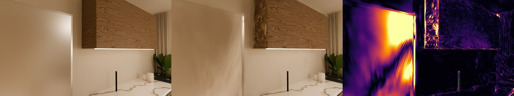
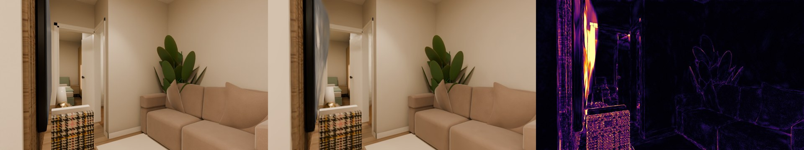
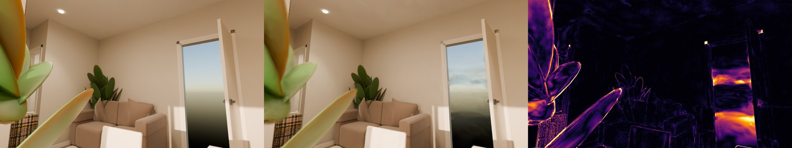
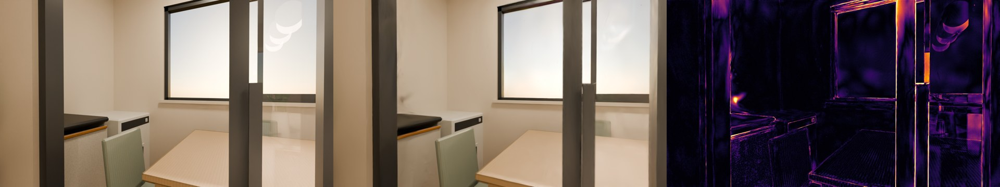
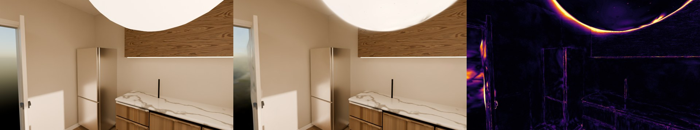
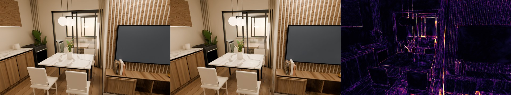

# Inspeção do splat — 40 vistas de teste

Meta por vista: PSNR ≥ 33.0 dB e SSIM ≥ 0.96. Média: PSNR 36.17 dB, SSIM 0.9749, LPIPS — (ns-eval: PSNR 36.20, SSIM 0.9781, LPIPS 0.0443). LPIPS por vista precisa de torch + lpips (não instalados aqui).

| Cômodo | Vistas | PSNR médio | PSNR mín. | SSIM | LPIPS | Abaixo da meta | Situação |
|---|---:|---:|---:|---:|---:|---:|---|
| Sala integrada · jantar | 9 | 34.23 | 30.10 | 0.9722 | — | 4 | **abaixo** |
| Sala integrada · cozinha | 12 | 35.57 | 23.06 | 0.9731 | — | 1 | **abaixo** |
| Sala integrada · estar | 19 | 37.47 | 33.01 | 0.9772 | — | 0 | ok |

## Mais vistas sugeridas

- **Sala integrada · jantar**: piores câmeras em [[-2.33, -0.39, 1.15], [-3.02, -0.01, 1.15], [-3.11, 0.71, 1.15]].
  `blender -b apartamento.blend --python capturar_splat.py -- --saida captura-extra --zona "Sala integrada" --passo 0.25 --prefixo salainte_`
- **Sala integrada · cozinha**: piores câmeras em [[-3.71, -2.08, 1.6], [-4.14, 0.37, 1.6], [-4.15, -1.03, 1.15]].
  `blender -b apartamento.blend --python capturar_splat.py -- --saida captura-extra --zona "Sala integrada" --passo 0.25 --prefixo salainte_`

## 6 piores vistas (Cycles | splat | erro)

- eval_img_0037.png (images/f0379.png, Sala integrada · cozinha, câmera [-3.71, -2.08, 1.6]): PSNR 23.06, SSIM 0.9363
  
- eval_img_0019.png (images/f0199.png, Sala integrada · jantar, câmera [-2.33, -0.39, 1.15]): PSNR 30.10, SSIM 0.9505
  
- eval_img_0007.png (images/f0079.png, Sala integrada · jantar, câmera [-3.02, -0.01, 1.15]): PSNR 31.13, SSIM 0.9600
  
- eval_img_0024.png (images/f0249.png, Sala integrada · jantar, câmera [-3.11, 0.71, 1.15]): PSNR 31.30, SSIM 0.9605
  
- eval_img_0027.png (images/f0279.png, Sala integrada · jantar, câmera [-2.66, -0.31, 1.6]): PSNR 31.62, SSIM 0.9749
  
- eval_img_0010.png (images/f0109.png, Sala integrada · estar, câmera [-1.98, -2.05, 1.6]): PSNR 33.01, SSIM 0.9625
  
