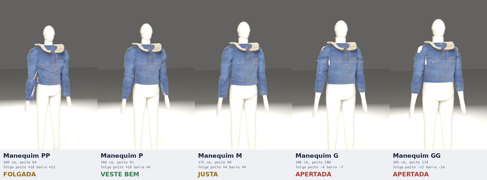

# Provador virtual: jaqueta trucker com gola sherpa

Teste de 04/11/2026. Uma jaqueta jeans com gola de sherpa, modelada no Blender a
partir de uma foto de produto, vestida em manequins de tamanhos diferentes e num
site onde a pessoa envia a própria foto.

A foto de referência não está no repositório. A peça é genérica: sem marca,
etiqueta ou logotipo.

## A peça tem tamanho fixo

A jaqueta tem um único tamanho, estimado pela foto (327×322 px). Duas réguas
concordam em ~4,2 px/cm: o cabide adulto de madeira (~44–45 cm entre as pontas,
que ficam nas costuras do ombro) e os botões de metal (~17 mm).

| Medida da peça | Estimativa |
|---|---|
| Ombro a ombro | 44 cm |
| Peito (circunferência externa) | 106 cm |
| Barra | 98 cm |
| Manga (ombro ao punho) | 62 cm |

A margem é de ±3 cm. As laterais do tronco ficam escondidas pelas mangas na foto.
O forro de sherpa tem ~7 mm, então por dentro o peito mede ~101,5 cm. A peça veste
confortável quem tem entre ~90 e ~98 cm de peito. Nos outros corpos ela fica
folgada ou apertada.

## Como funciona

`blender/modelo.py` gera o manequim e a jaqueta a partir de cinco medidas:
altura, ombros, peito, cintura e quadril. Toda posição de vértice é função
linear delas (erro medido: 4e-16 m). Por isso cada medida vira um shape key exato
do manequim, e o site deforma o corpo em tempo real só mexendo nas influências.
A jaqueta é exportada já no tamanho da peça, sem shape keys. No site ela só sobe
ou desce para apoiar nos ombros do corpo.

| Arquivo | O que faz |
|---|---|
| `blender/modelo.py` | Geometria paramétrica: corpo, casca e forro da jaqueta, gola, botões, medidas da peça |
| `blender/texturas.py` | Denim procedural (sarja, slubs, stone wash, pespontos dourados, pala, bolsos, cós, desgaste das costuras) e sherpa (cor + normal map) |
| `blender/cena.py` | Objetos, materiais PBR (denim, sherpa com sheen, cobre), estúdio Cycles |
| `blender/construir.py` | Exporta `site/modelos/manequim.glb`, `jaqueta.glb` e `provador.json` (folgas) |
| `blender/teste_tamanhos.py` | Simulação de tecido (Cloth) da mesma jaqueta em manequins PP a GG |
| `blender/foto_sintetica.py` | Gera uma "foto" de manequim com medidas conhecidas para testar o site |
| `site/index.html` | O provador: foto → medidas → manequim → jaqueta → veredito por região |

Versão publicada (privada): https://claude.ai/artifact/LQKjpjQxHsP3XF9ZpZafsU.
Esse host não serve `.glb` nem `.task`, então ali os modelos vão como glTF em
JSON (`blender/glb_para_json.py`) e o detector de pose vai em base64 num `.txt`.
O site tenta os formatos nessa ordem.

O Blender usado é o módulo `bpy` 5.2.3, que roda sem interface. Para montar:
`./montar.sh`. Os GLBs, as texturas e o detector de pose ficam fora do git porque
passam de 1 MiB (ver `tasks/higiene-repositorio/arquivos-grandes.md`).

## Teste em manequins (simulação de tecido)

O manequim começa estreito, dentro da peça, e cresce até as medidas finais nos
primeiros 18 quadros. O Cloth simula a casca externa: denim rígido, massa de
0,45 kg/m², colisão com o corpo. Forro, gola e botões copiam o deslocamento da
casca externa da mesma parte. A cava sob a manga fica fora da colisão, porque ali
o braço atravessa o tronco.

| Manequim | Peito do corpo | Folga peito | Folga barra | Ombro | Estiramento p95 | Resultado |
|---|---|---|---|---|---|---|
| PP | 84 | +17,5 | +12,2 | +5,0 | 0,7 % | folgada, mangas cobrem as mãos |
| P | 91 | +10,5 | +5,8 | +3,0 | 1,2 % | veste bem |
| M | 98 | +3,5 | +0,1 | 0,0 | 1,2 % | justa |
| G | 106 | −4,5 | −7,4 | −2,0 | 9,9 % | apertada, não fecha |
| GG | 114 | −12,5 | −15,5 | −4,0 | 34,4 % | muito apertada; a malha rasga no ombro |

Folgas em cm, medidas por dentro do forro. Os números estão em `teste/resultado.json`.
Cada simulação levou de 35 a 105 s em 4 CPUs.

## Medidas pela foto

A página usa o MediaPipe Pose Landmarker (lite) com máscara de segmentação, no
navegador. A foto não sai do aparelho. A altura informada dá a escala, do topo da
cabeça na máscara até os pés. Os ombros vêm dos landmarks. Peito, cintura e
quadril vêm da largura da máscara em linhas fixas entre ombros e quadris,
convertida em circunferência por elipse. Se os braços estiverem colados ao
tronco, o peito é medido mais abaixo e convertido pela geometria do manequim.
Se mesmo assim não der, a página usa proporções médias e avisa.

Com fotos sintéticas (`foto_sintetica.py`, braços a 35°), a estimativa ficou assim:

| Corpo | Ombros | Peito | Cintura | Quadril |
|---|---|---|---|---|
| G real → estimado | 46 → 44,8 | 106 → 103,4 | 94 → 95,0 | 105 → 105,6 |
| PP real → estimado | 39 → 37,2 | 84 → 82,0 | 70 → 73,6 | 88 → 88,0 |

## Limitações

- O teste de foto usou o próprio manequim. Com pessoas reais (roupas largas, pose,
  lente do celular), espere erros maiores, de ±5 a 8 cm. Por isso as medidas
  ficam editáveis nas fitas.
- No site o caimento não é simulado: a jaqueta rígida aparece por cima do corpo,
  e onde aperta o corpo atravessa o tecido. A simulação de tecido está só no
  teste do Blender.
- Com o delegado CPU, a máscara de segmentação do MediaPipe 0.10.14 e 0.10.20
  aborta (`Check failed: 1 == ChannelSize()`). O site usa o delegado GPU (WebGL).
- O manequim é unissex e simplificado: não tem busto feminino nem variação de postura.
