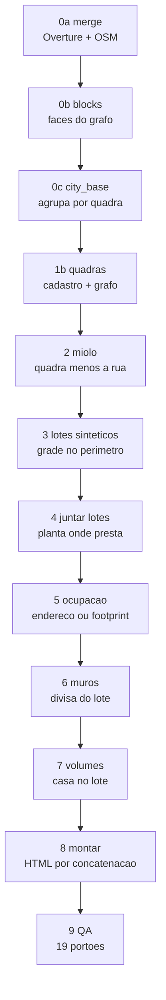

# Cronologia do projeto Imobiliária

2026-09-22

## O que é o projeto

Um mapa 3D de cidade inteira que abre no navegador, onde cada imóvel cadastrado tem ficha, maquete, planta e visita em primeira pessoa dentro da casa. A base atual é a **1.5**, em desenvolvimento — não uma release aprovada.

O trabalho registrado vai de **21/08/2026 a 21/09/2026**: 31 dias, 16 versões de renderizador (v3 a v18), 5 cidades construídas e depois reduzidas a uma.

| item | estado em 21/09/2026 |
| --- | --- |
| cidade em escopo | São Carlos, só ela |
| edificações na base | 96.168 volumes |
| página montada | 32,9 MB aberta / 14,0 MB comprimida |
| chamadas de desenho | \~270 a 340 por quadro |
| imóveis cadastrados | 5 (mirra-114 + 4 lançamentos MRV/Maria Aires) |
| portões de QA | 19 (10 de geometria, 9 de comportamento) |
| testes | 43 Python, 111 Node (10 falhando) |

As outras quatro cidades (Araraquara, Ribeirão Preto, Sorocaba, São José do Rio Preto) têm dado no acervo, mas a página delas não é montada há semanas. Medir aparência nelas seria medir uma versão que ninguém vai publicar.

## Tecnologias

A regra que organiza o stack inteiro: **nada é buscado em tempo de execução**. A página precisa abrir por duplo clique em `file://`, onde `fetch` é bloqueado por origem opaca — então toda fonte vira JSON embutido pelo pipeline.

| camada | o que é usado |
| --- | --- |
| dados de edificação | Overture Maps (67% Google Open Buildings + 33% Microsoft ML Buildings) |
| ruas e POIs | OpenStreetMap — Overpass no início, extract do Geofabrik depois |
| relevo | open-elevation, grade 44×44 sobre 5,5 km |
| cadastro municipal | SigaSC/MapServer (São Carlos), ArcGIS REST (Ribeirão Preto) |
| endereços | CNEFE/IBGE Censo 2022, GeoJSON por município |
| plantas oficiais | OpenPlots — 265 pranchas TIF escaneadas |
| pipeline | Python 3.11: shapely, opencv-headless, scikit-image, pyproj, rapidocr |
| renderizador | three.js (r128 → r168), earcut, WebGL, shaders GLSL por `onBeforeCompile` |
| 3D offline | Blender 5.2 headless — árvores, móveis, quintais, bake no Cycles |
| experimento | Unreal Engine 5.8 via MCP, para lightmap e teste controlado |
| QA | Chrome headless (hoje `chrome-headless-shell` do Playwright), sondas em Python e Node |
| publicação | Firebase Hosting + Firestore |

Três escolhas técnicas explicam quase toda a arquitetura:

1. **O gargalo é chamada de desenho, não triângulo.** Medido em 23 µs por chamada; cortar triângulos de 1,98 M para 625 mil mudou o quadro em zero. Por isso geometria por casa é de graça e detalhe se desenha no *fragment shader*, nunca modelando malha nova.
2. **A malha é mesclada por quarteirão e transmitida sob demanda.** Só o que está a 700 m da câmera existe na GPU.
3. **Nenhuma imagem entra na página.** Telha, muro, asfalto e reboco são desenhados em GLSL a partir da normal do triângulo e da derivada da posição — zero byte, zero chamada extra.

## Como o dado foi trabalhado — as fontes

São cinco fontes com papéis que **não se sobrepõem**. Confundi-los foi a origem da maior parte do retrabalho do projeto, e a frase que resolveu está escrita no `PIPELINE.md`:

> O **Overture** diz ONDE tem casa. A **planta** diz QUANTO mede o terreno. A **quadra** diz ONDE ele cabe. O **endereço** diz SE está construído. Nenhuma delas sozinha faz o mapa.

| fonte | o que é | serve para | não dá |
| --- | --- | --- | --- |
| Overture Maps | 126k footprints, 75 MB | onde existe construção | divisa de lote; 1 casa = 3 polígonos |
| OSM / Overpass | ruas, nomes, `building:levels` | malha viária e nome próprio | cobertura de edificação (só 4.528 de 125.994 casam) |
| SigaSC `quadras_pol` | 3.373 quarteirões | o polígono da quadra oficial | não cobre a cidade toda |
| SigaSC `enderecamento` | 54k pontos | prova de que o lote está construído | geometria de lote |
| OpenPlots | 265 plantas urbanísticas | o **tamanho** do terreno por bairro | georreferência — a planta é um TIF escaneado |

### O que cada uma exigiu para virar dado utilizável

**Overture — telhado de satélite, não cadastro.** As fontes internas do arquivo são Google Open Buildings e Microsoft ML Buildings. Isso explica todo o comportamento dele: casa + garagem + edícula viram três polígonos, vêm tortos e ignoram divisa. Foi por isso que, do v5 em diante, o mapa **parou de desenhar o footprint** e passou a assentar uma casa no lote, usando o Overture apenas como prova de ocupação. A mediana de vértices por contorno era **4** — caixa, não casa.

**SigaSC — toda fonte da prefeitura saiu por visão computacional.** WFS não publica layer (falta `DUMP TRUE`) e WMS devolve `InvalidSRS`. Não há como pedir vetor por OGC. O que funciona é o modo CGI nativo, que devolve **PNG transparente** — então o pipeline é raster: `sonda` (células de 3 km a 300 px, só para achar onde tem tinta — o `quadras_pol` acendeu 22 de 132 células, e renderizar tudo em alta seria 6× o download), `tiles` (2048 px, retomável), `mosaico` (máscara de cor + maxpool + costura) e `faces` (o layer é desenhado a linha: a feição é o **vão entre** as linhas) ou `pontos` (blob → centroide).

Quatro armadilhas nesse caminho, todas pagas em tempo:

- **A projeção mente.** O mapfile rotula `zone=21`, o dado está em UTM 23S. Reprojetar como EPSG:29193 encaixa. Errar não dá erro — dá cidade deformada.
- **Dilatação de 4 px, não 2.** Com 2, polígono grande e alongado vaza por gaps de \~4 px nas emendas de tile e cai no fundo. Foi assim que o bairro Santa Angelina sumiu.
- **`enderecamento` tem `MAXSCALE 5000`** — não desenha em célula de 3 km. Tiles de 1.500 m, 4× mais requisições.
- **Layer sem dado devolve PNG idêntico a "fora de escala".** No Jardim Araucária o `quadras_pol` deu 0,34% de pixel e o `enderecamento` **0,00%**, contra 1,73% e 1,26% num bairro de controle. Antes de concluir que a raspagem ficou curta, sonde um bairro que você sabe que existe.

**OpenPlots — 265 pranchas de CAD escaneado.** TIF bitonal Group4, 200 ou 300 dpi, sem CRS. Cada uma traz o selo `HISTÓRICO DO USO DAS ÁREAS`, a escala (1:1000, 1:2000 ou 1:2500, variando por prancha) e um `OBS:` com a cota padrão do loteamento ("todos os lotes sem dimensões medem 6 × 23"). Cada planta é vetorizada, encaixada na quadra oficial e submetida a exame — **a planta é o gabarito**: lote fora do tamanho padrão da própria planta não é lote, é erro de extração, e sai. Resultado: 21.163 lotes confiáveis em 67 bairros.

**Endereço — de 54 mil para 166 mil.** O `enderecamento` do SigaSC deu 54.111 pontos. O CNEFE do IBGE (Censo 2022) deu 143.200 só para São Carlos, georreferenciados, de graça e para **qualquer** município. Duas coisas fazem esse dado prestar: a escala `NV_GEO_COORD` é invertida (1 é a melhor, coordenada original do Censo; 4 e 5 são aproximação e se descartam) e uma tolerância de **8 m** na hora de casar ponto com lote — com contenção estrita só 28,6% caem dentro; com 8 m, **76,1%**. A causa é física: o ponto é coletado na **testada**, e a distância mediana dele ao lote é de 3,0 m.

## A cadeia: da fonte bruta ao HTML

O pipeline é uma linha de montagem de 14 etapas. Cada uma tem **contrato declarado** — o que entra, o que sai — e etapa que quebra **para o runner**, em vez de deixar a seguinte ler lixo.

**0a — o prédio ganha semântica.** Cruza Overture com tags do OSM e atribui classe (0/1 residencial, 2 comércio, 3 cívico), nome e endereço. Só 4.528 de 125.994 casam; o resto fica anônimo — e é por isso que a etapa 7 descarta o footprint anônimo e mantém só o nomeado.

**0b — a face do grafo.** Extrai as faces do grafo planar formado pelas ruas que de fato delimitam quadra: só `kind` 0-8 e 15-20; `service`, `track` e `footway` cortam por dentro e fatiariam a quadra em cacos. Foram criadas para o streaming e **viraram, meses depois, a fonte de quadra** onde o cadastro não chega.

**2 — o miolo, a definição que custou três rodadas.** O miolo não é a quadra menos a rua *real*: é a quadra menos a rua **como o renderizador a desenha** (`ROAD_W/2 × 1,55`). Enquanto o pipeline usava outra conta, o muro flutuava na rua residencial (2,04 m de folga) e ficava em cima do asfalto na avenida (fita entrando 1 m no lote).

**3 e 4 — onde mora o custo.** Juntas são 40% do tempo do pipeline. A etapa 3 caminha o perímetro do miolo criando lotes; a 4 arbitra, **por quadra**, se usa a planta oficial ou a grade sintética — porque uma planta com encaixe global de 0,99 pode estar 42° fora num quarteirão específico.

**5 — ocupação.** Só recebe casa o lote que tem endereço **ou** footprint dentro. É o que impede a cidade de virar um tabuleiro de casas iguais em terreno vazio.

| etapa | s |  | etapa | s |
| --- | --- | --- | --- | --- |
| 1b quadras do grafo | 41 |  | 7 volumes | 76 |
| 2 miolo | 18 |  | 7b chão | 3 |
| 3 lotes sintéticos | 123 |  | 7b ruas | 68 |
| 4 juntar lotes | 68 |  | 8 montar | 0,2 |
| 5 ocupação | 23 |  | 9 QA | 41 |
| 6 muros | 18 |  | **total** | **485 s** |

Oito minutos do `city_base` ao HTML aprovado. As etapas de rede são outra ordem de grandeza — horas — e por isso são opt-in e retomáveis.

### As três armadilhas de ordem

Todas morderam, todas custaram uma rodada, e todas têm a mesma forma: **um arquivo que não acompanhou o outro**.

1. **A etapa 5 guarda índices, não ids.** Mexeu na lista de lotes da 4, tem que rodar a 5 de novo — senão a casa nasce no lote do vizinho.
2. **A etapa 7 precisa ler a mesma lista de quadras da 2.** Enquanto lia o cadastro puro com miolo vindo do completo, a quadra nova ficava sem ângulo e sem centro: **11.237 casas descartadas por sobreposição**, e um bairro saiu com 5 casas em 99 lotes ocupados.
3. **A etapa 7b idem.** Chão e asfalto gerados com as quadras antigas deixavam o bairro novo **sem chão** (prédio flutua com o Relevo) e com o **asfalto por cima das casas** — porque a rua é `(vão + corredores) − quadras`.

O frescor é por **sha1 do conteúdo**, não por data de arquivo. Sem isso, regerar um artefato idêntico marcava metade do pipeline como velha — foi o que aconteceu com o `blocks.json`, que sai byte a byte igual.

## O formato da base: como uma cidade cabe em MB

A cidade inteira é um JSON de arrays de inteiros. Não há objeto por prédio, não há chave repetida, não há ponto flutuante.

**A projeção.** Tudo é convertido para metros locais na borda: `x = (lon − lon0) × MLON`, `z = −(lat − lat0) × MLAT`, com `MLAT = 111132,92` e `MLON = 111319,49 × cos(lat)`. Depois multiplica por `Q = 10` e vira **decímetro inteiro**. A decisão de guardar lat/lon (SRID 4326) e converter só na borda do cliente é o que permite o mesmo dado servir outras aplicações: metro local é detalhe do renderizador.

**O registro de um prédio** em `b[]` é `[classe, altura×10, número de pontos, dx, dz, dx, dz, …]` — os vértices são **deltas** em decímetro, e os deltas **zeram a cada prédio**. Esse detalhe, que parece trivial, é o que tornou o streaming possível: como cada edificação é um bloco independente do array, dá para **reordenar** `b[]` agrupando por quadra sem corromper uma única coordenada.

**O índice de quarteirão** é `bl[] = [cx, cz, raio, início, quantidade]`. Com ele a página monta só o que está a 700 m da câmera. Foi essa uma linha de estrutura que rendeu **1.281 → 238 chamadas de desenho** e **224 → 15 MB de VRAM**.

### Três economias que valem mais que compressão

| economia | antes | depois |
| --- | --- | --- |
| coordenada com 7 casas em vez de 17 | 254,7 MB de acervo | 182,4 MB |
| atributos mortos (`normal`, `aDY` em malha que não os lê) | 82,7 MB na GPU | 58,4 MB |
| corte por frustum religado (esfera inflada) | 838 chamadas | 172 |

A primeira merece nota: **1e-15 grau é 0,1 nanômetro**. A fonte é raster vetorizado, com \~6% de erro próprio — sete casas decimais (1,1 cm) já é mais precisão do que o dado tem.

### O que é embutido e por quê

A página precisa abrir em `file://`, onde cada arquivo local é uma **origem própria** e `fetch` é bloqueado. Então o `montar.py` embute, por concatenação de peças: three.js e earcut (no lugar de quatro `<script src>` de CDN), a base da cidade, a grade de relevo (senão o botão Relevo dependeria da open-elevation e morreria offline), os POIs, a biblioteca de árvores, a de móveis e as texturas de fachada.

O relevo merece um parênteses porque ele **não está no `city.json`**: é uma grade de 80×80 baixada à parte. O acoplamento entre prédio e terreno é por **coordenada**, não por índice — o que significa que dá para regerar `b[]` inteiro sem tocar em elevação. Casa movida, nova ou remodelada cai no terreno certo sozinha.

O preço dessa escolha está medido: a página de duplo clique é de 32,9 MB aberta (14,0 MB comprimida), e a cota gratuita de download do Firebase acaba em **\~110 visitas por dia** a 9 MB por visita — número de 01/09, revisto em 22/09 (abaixo). É por isso que existe o **recorte por imóvel** (uma página por unidade, \~4,5 MB gzip a 2,5 km de raio) — e por que ele encontra um **piso de 10,4 MB** que o raio não toca: 5,58 MB de biblioteca exterior mais 4,80 MB de código, móveis, árvores e texturas.

## O dado do imóvel: do anúncio à parede

A cidade é dado público tratado em lote. O imóvel é o oposto: **cadastro, um a um, fornecido por você**. Essa separação foi decisão sua em 29/08 e organiza tudo que veio depois.

**A entrada é imagem de anúncio.** `plantas_fornecidas/<id>/` guarda `unidade.json` (cômodos em metros, pé-direito, cores, móveis com ponto e giro), a planta em PNG/JPG e as fotos. As fotos não são galeria — são **fonte de informação**: piso por ambiente, cor de parede, layout quando não há planta.

**A parede não é desenhada, é derivada.** O cadastro tem retângulos de cômodo; uma grade de 5 cm decide onde há divisa, e a divisa vira prisma de 13 cm de espessura. Consequência direta: **toda divisa vira parede**, e o 3D de um imóvel inteiro pesa **10 KB** — não existe `.glb` no caminho.

**O extrator de planta** (01/09) tirou o gargalo real, que não era o 3D: até ali, transcrever planta para `unidade.json` era 100% manual. A divisão de trabalho que funcionou:

- **CV acha parede** com precisão de poucos px (traço escuro + abertura direcional de 60 px mata móvel e texto). As linhas achadas reproduzem sozinhas a escala que a pessoa tinha medido à mão: 109 px/m contra os "\~110" anotados.
- **CV não sabe qual retângulo é qual cômodo.** Watershed semeado nos rótulos deu 26% de dispersão — ele não sabe que o branco à direita é "fora", não a suíte. Essa metade é de visão/pessoa.
- **A escala sai das áreas rotuladas**, por média geométrica das razões — a aritmética deixaria a suíte de 11,5 m² mandar sozinha e calaria o banho de 3 m².

**Desconfiar do anúncio é regra.** No primeiro caso de teste, planta e ficha eram de **unidades diferentes**: a planta somava 64,40 m² com 1 suíte contra ficha de 114,32 m² com 3 suítes. Conferir área rotulada contra a ficha antes de extrair.

### Quando o prédio não existe

Lançamento é o caso comum num acervo de imobiliária, e a base de edificação é foto de satélite — **se a torre não estava de pé na captura, o dado tem lote vazio**. Antes disso, a ficha nem abria: pedia "clique no prédio do empreendimento", o que convida a pendurar o imóvel no vizinho.

A solução foi um bloco `lote: {lat, lon, rumo_graus}` no cadastro que **vence** as três fontes de prédio, porque não é mais uma pista sobre onde o prédio está: é a afirmação de que prédio não há. E em vez de espalhar `if` por toda parte, o lote **fabrica um registro** com a mesma forma de um prédio real — o resto do programa não sabe a diferença.

Para os quatro lançamentos da Maria Aires, sitiar o terreno usou três fontes em ordem de força: **CNEFE** (dá os vizinhos numerados da via e interpola — e o número do lançamento *não* estar lá confirma que o terreno era vago em 2022), imagem aérea da Esri, e o `__NEXT_DATA__` do próprio site, que traz endereço, área, preço e a lista completa de fotos — inclusive as 8 que o carrossel nunca carrega.

Depois eles deixaram de ser um prisma cada: `lote.predio.blocos` virou uma **lista de volumes** com giro próprio, o que permite o "L" de um MRV. Sai de graça porque todos entram no mesmo grupo de streaming e viram uma malha só — quatro blocos mais portaria custam as mesmas chamadas de desenho que a caixa que substituíram.

## Agosto/2026 — construir a cidade

O mês começa com uma página de 6,9 MB editada à mão e termina com pipeline reprodutível, cinco cidades e 4,4 MB.

| data | mudança | número que a justifica |
| --- | --- | --- |
| 21/08 | POIs (mercado, saúde) embutidos no HTML por `build_pois.py` | 82 pontos, corte de 10 km do centro |
| 22/08 | `build_blocks.py` extrai quarteirão das faces do grafo de ruas | 4.457 quadras, área mediana 9.980 m² |
| 22/08 | **v4: streaming por quarteirão** | 14,97 → 1,88 ms; 1.281 → 238 chamadas; 224 → 15 MB de VRAM |
| 23/08 | **v5: base fora do HTML**, buscada por `fetch` | página 6,6 MB → 107 KB |
| 25/08 | Espaço de cor: `LinearEncoding` → `sRGBEncoding` | telhado deixou de nascer preto |
| 25/08 | Tipologia: 8 arquétipos de edificação por sorteio determinístico | 882 → 882 chamadas, +29% de triângulo |
| 25/08 | Loteamentos oficiais vetorizados do SigaSC | 234 polígonos, 224 nomeados |
| 26/08 | **Lotes reconstruídos** por subdivisão de quadra | 113.501 lotes; frente 9,9 m × fundo 25,0 m contra 10×25 da planta |
| 26/08 | **v6: duplo clique** com tudo embutido | \~4 MB; POIs 82 → 931 |
| 27/08 | Acervo OpenPlots baixado inteiro | 265 plantas, 169 MB |
| 28/08 | **v7: casa assentada no lote da planta oficial** | 86.228 prédios |
| 28/08 | Anél invertido: `insetRing` inflava em vez de encolher | 9.520 casas de laje contra 65 com telhado — corrigido |
| 28/08 | **v8: metade do peso** | 10,9 → 4,4 MB; 838 → 172 chamadas |
| 28/08 | Limpeza do acervo: 7 casas decimais em vez de 17 | −72 MB |

Duas coisas custaram um ciclo inteiro e viraram método:

- **Screenshot não distingue "cor errada" de "normal invertida"** — as duas dão cinza escuro. Pintar a laje de magenta puro separou as hipóteses em um print.
- **O rAF trava em aba oculta.** A cidade só monta com a aba visível; sem um *shim*, o baseline sem alteração nenhuma trava igual.

### Por que agosto foi assim, e o que ele destravou

**O streaming (22/08) foi o que tornou o resto possível.** Antes dele o quadro custava 14,97 ms com a cidade parada — sem margem para telhado, árvore, muro ou textura. Depois, 1,88 ms. Cada melhoria visual de setembro só coube no orçamento porque essa medida foi feita primeiro. E ela veio junto do achado que rege tudo: cortar triângulos de 1,98 M para 625 mil mudou o quadro em **zero** — o custo é submissão, 23 µs por chamada.

**O v5 tirou o dado da página por um motivo de produto, não de peso.** Seu objetivo declarado era o mapa virar plataforma: multi-usuário, backend, outras aplicações lendo o mesmo dado, sistema de lojas com estoque. Enquanto a base morasse dentro do HTML, ela só existia para aquela página. O efeito colateral foi perder o duplo clique — e aí veio o v6, que reembute tudo. **As duas saídas convivem de propósito**: são incompatíveis por construção, não por bug.

**Os lotes (26/08) mudaram o que o mapa é.** Sua observação com planta × mapa na mão: as casas eram footprints jogados soltos e tortos, sem respeitar divisa — inútil para depois confirmar ou posicionar um imóvel. Como não existe camada georreferenciada de lote privado em lugar nenhum, a grade foi **reconstruída** das quadras. A validação é o ponto: medindo os 2.558 lotes gerados dentro do Jardim Embaré contra a planta oficial cotada em 10,00 × 25,00 m, saiu **frente mediana 9,9 m, fundo 25,0 m, área mediana 247 m²**. A partir daí o mapa deixou de ser ilustração e virou cadastro aproximado.

**O anel invertido (28/08) é o exemplo do tipo de defeito que domina este projeto.** Duas convenções de orientação conviviam no mesmo arquivo: 1.389 anéis com `shoelace < 0` do Overture e 57.607 com `shoelace > 0` gerados pelo pipeline. Com o sinal trocado, a função que deveria encolher o contorno **inflava** — casa 1 m maior por lado, jogando fora recuo e quintal, e a retangularidade caindo de 0,99 para 0,66, abaixo do limiar que libera telhado. Resultado na tela: **9.520 casas de laje contra 65 com telhado**. Era isso que fazia bairro inteiro parecer a mesma casa. Não havia erro no código do telhado.

## 29/08 a 31/08 — virar produto repetível

Pedido seu, em 29/08: *"o projeto vai ser aplicado para várias cidades, temos que criar um padrão correto pra evitar retrabalho"*. Três dias reescreveram a fundação.

1. **`PADRAO.md` e `padrao/cidades/<slug>.json`.** Um conceito, uma definição, num arquivo de dado: projeção, origem, largura de via, limiares de QA e caminho de cada fonte. Reclamação visual atendida vira **portão com limiar** — `rodar_qa.py` sai com código 1 se reprovar, e o build não sai.
2. **O renderizador ganhou arquivo.** Até 29/08 os 97 KB de JS moravam dentro de um HTML de 6,9 MB editado à mão, e a página saía de **59 âncoras de busca-e-substitui** encadeadas (`make_v4` → `v5` → `v7` → `v8`). Virou `renderizador/{app.js, estilo.css, …}` + `pipeline/montar.py`. A extração foi do **fim** da cadeia: a fonte da verdade é o HTML que já passou nos portões.
3. **`pipeline/rodar.py` executa tudo**, do download ao HTML, com frescor por sha1 do conteúdo e não por data.
4. **A face do grafo de ruas substitui a quadra do cadastro.** O `quadras_pol` do SigaSC não cobre São Carlos inteira e bairros sumiam: Jardim Araucária 797 → 0, Eduardo Abdelnur 1.857 → 0. Com a face: **63.565 → 74.989 volumes**.
5. **Araraquara, a segunda cidade**, rodou o padrão sem nenhum dado de prefeitura. O teste quebrou 7 coisas que só aparecem rodando de verdade — entre elas, o pipeline lendo o Overture de São Carlos e processando as 171 plantas dela.

Depois vieram Ribeirão Preto, Sorocaba e São José do Rio Preto: **\~20 min e \~200 MB por cidade**, 0 portões reprovados em cada. O Overpass devolvia `HTTP 429` na quarta consulta, então o OSM passou a vir de um extract único do Geofabrik (Sudeste, 856 MB).

Nos dois últimos dias do mês entraram **arborização** (v10, 20 espécies geradas no Blender, `InstancedMesh` por espécie), **níveis de gráfico** (resposta a *"em computador fraco é horrível de travado"*), **quadro preguiçoso** (v11) e **telha, muro e tela no fragmento** (v12, a partir de *"tá parecendo um jogo do Roblox"*).

### O retrabalho que o padrão matou

O `PADRAO.md` abre dizendo qual era a doença: **o mesmo conceito estava escrito em mais de um lugar, com valores diferentes**. O exemplo canonico é a largura da rua, que existia em quatro arquivos, e ninguém estava "errado" — cada um tinha uma conta razoável:

| via | onde a rua acaba (desenhada) | onde o pipeline cortava | o que apareceu na tela |
| --- | --- | --- | --- |
| residencial 7,5 m | 5,81 m | 7,85 m | 2,04 m de folga — muro não encostava |
| primária 13 m | 10,07 m | 9,10 m | fita entra 1 m no lote — muro sobre o asfalto |

Três rodadas de investigação para achar isso. Depois da regra, o muro dentro da rua caiu de **5,29% para 0,22%** do comprimento, e a conta passou a ter uma implementação só.

**O carimbo de build no HUD nasceu de um mal-entendido concreto:** você mandou print de um bairro dizendo que continuava quebrado, e o print era do **arquivo anterior** — a mesma cena no build novo estava certa. Desde então cada página diz cidade, versão e data/hora no canto.

**A face do grafo salvou bairros inteiros.** Não era falha de raspagem: sondando o MapServer no extent do Jardim Araucária, o cadastro simplesmente **não tem dado ali**. Como sem quadra não há miolo, nem lote, nem casa, o v7 punha 57 casas onde o v4 tinha 797 footprints. A prova de que a face do grafo serve de quadra é numérica: nas 3.270 quadras onde as duas fontes existem, IoU mediana **0,85** e 94% da quadra oficial contida na face — e a razão miolo/quadra deu **76% nas duas cidades**, uma vinda do cadastro e outra só do grafo.

**O renderizador virar arquivo foi condição para tudo que veio depois.** Enquanto a página saía de 59 âncoras de busca-e-substitui encadeadas, qualquer mudança era uma aposta: âncora não única quebrava o build, e o JS "oficial" era um arquivo de 6,9 MB editado à mão que ninguém gerava. A extração foi feita do **fim** da cadeia, não do começo — a fonte da verdade é o HTML que já passou nos portões — e o aceite foi peça a peça: dado, CSS, three.js e earcut idênticos, `app.js` diferindo em 5 linhas, todas de propósito.

**Araraquara foi o teste real do padrão**, e quebrou 7 coisas que não aparecem lendo código: o merge lendo o Overture de São Carlos (prédios 25 km deslocados, 126 mil órfãos), a etapa de plantas processando as 171 pranchas da cidade errada, e o CRS — Araraquara é fuso 22 (EPSG:31982), não 23. Errar o fuso não dá erro; dá cidade deformada.

## Setembro, 1 a 8 — entrar na casa

A cidade estava de pé; o mês foi sobre o que se vê **dentro** do imóvel, e sobre a diferença entre "parece bom" e "medi que está bom".

A decisão que abriu esta fase foi sua, em 29/08: *"os dados de planta e fotos sou eu que vou fornecer"* e *"não são todas as casas que terão 3d interno — remova os 3d internos genéricos"*. O gerador automático de planta (BSP) foi removido inteiro. **Prédio sem unidade cadastrada não abre porta.**

| data | mudança |
| --- | --- |
| 01/09 | v13: a vitrine para na **ficha**, não entra na casa; coluna "o que tem por perto" num raio de 1 km |
| 01/09 | Aceite de comportamento: as 9 sondas soltas viraram portão, 223 s por cidade |
| 01/09 | Extrator de planta: CV acha parede, pessoa diz qual cômodo é qual, área rotulada calibra a escala |
| 03/09 | Rua e parede recalibradas contra foto aérea; asfalto tem que **sair frio** pra chegar neutro |
| 03/09 | Geoportal de Ribeirão (API REST aberta): 231.572 lotes com IPTU |
| 03/09 | CNEFE/IBGE entra como prova de ocupação: São Carlos 54.111 → 143.200 endereços |
| 04/09 | Quatro lançamentos da Maria Aires modelados e plantados no lote |
| 04/09 | Miolo vazio: o lote parava em 25 m numa quadra de 86 m — cobertura 76,9% → 93,8% |
| 04/09 | Clone de São Carlos refeito: 77.145 → **96.168 prédios** |
| 04/09 | **v15: bake de luz** — oclusão de ambiente em JS, escrita na cor por vértice, zero chamada a mais |
| 05/09 | A casa nunca projetou sombra: faltava `castShadow` — o sol atravessava forro e parede |
| 05/09 | Sonda de ambiente (`CubeCamera` + PMREM) no lugar do degradê equirretangular |
| 05/09 | Mobiliar automático: layout deduzido da planta, com três formas de recusar |
| 07/09 | **v16**, clone do v15: plafom preto e forro alaranjado consertados |
| 07/09 | O céu da cidade já estava escrito, trancado dentro de casa — ligar custou +1 chamada |
| 08/09 | Móveis modelados no Blender headless; depois paramétricos (sofá ganha assento, armário ganha coluna) |
| 08/09 | **A elevação do sol era a alavanca**: `SOL_OFF.y` 940 → 476 levou a sombra de 2% para 18,8% do quadro |

O episódio mais caro do mês foi o **Unreal**. Você pediu bake com Lumen; eu recusei por custo de produto e você respondeu *"e quando eu falei que você poderia escolher entre fazer ou não? eu preciso que seja feito"*. Foi feito, e rendeu duas coisas: um pipeline de lightmap funcionando (commandlet renderiza mas **não ilumina** — Lumen precisa de quadros passando) e um **teste controlado** que mediu 2,4× mais faixa dinâmica a favor do Unreal, com cor chapada e sem textura. Sua escolha depois disso foi fechar o vale **dentro do three**, não migrar.

### Por que a luz dominou o mês

Duas frases suas orientaram setembro inteiro: *"tá parecendo um jogo do Roblox"* e *"está horroroso vey"*. O diagnóstico nunca veio de raciocínio — veio de **fotografar e medir**, e quase toda hipótese razoável caiu.

**O ACES é o personagem escondido do projeto.** O tone mapper comprime e **dessatura o topo da curva**. Consequências que só apareceram medindo:

- Cor clara não carrega matiz. Trocar os hex das paredes grandes mantendo o valor alto quase não mudou nada (saturação 0,059 → 0,077); **baixar o leque 10%** levou a 0,084 e derrubou o estourado de 22,6% para 17,5%.
- O asfalto tem que **sair frio para chegar neutro**: `0x141B29`, calibrado olhando a rua de perto, chega na tela como (80,97,123) visto de cima — azul-aço. A culpa é da hemisférica, que bate inteira numa face horizontal.
- A textura da rua errou a amplitude por **5×** no primeiro palpite, porque a rua vive na parte alta da curva, que é justo onde o ACES comprime.

**O portão fabricava o defeito.** O aceite de interior exigia luminosidade média entre 120 e 175, e as cores do cadastro foram calibradas *para caber nele* — está escrito no comentário de uma delas. Medindo o nosso quadro contra a referência que você mandou: **0,0% de pixel abaixo de 70 e saturação média 0,044**. A cena não tinha preto e não tinha cor — e nenhuma textura ia consertar enquanto o portão mandasse o contrário. Desde então há critério que exige **presença**: escuro > 2,5% e croma > 0,09.

**O Unreal valeu pelo número, não pelo pipeline.** O teste controlado — mesma geometria, mesmos móveis, mesma câmera, mesmas luminárias, brilho médio igualado — deu faixa dinâmica **64,1 no three contra 156,8 no Unreal**, e o UE ganhou **com cor chapada, sem textura, sem normal map**. O diagnóstico estava no `escuro = 0,00%`: o apartamento não tinha um único pixel escuro, que é a assinatura de preenchimento falso, não de motor ruim. Foi esse número que justificou o bake de oclusão, a sonda de ambiente e, por fim, `castShadow` na casa.

**As três queixas de "luz vazando" não eram luz vazando:**

| você viu | era | conserto |
| --- | --- | --- |
| sombra vindo "do além", luz atravessando parede | a casa **nunca** teve `castShadow` — o sol entrava pelo forro | uma linha; e o portão **melhorou** |
| luz vazando pelas frestas | z-fighting: a tampa do prisma da parede é coplanar com o forro | parede sobe 6 cm; crista de luz +30,2 → +3,9 |
| a quina perto do chão ilumina a parede | o raio do bake descia, não batia em nada e voltava como **céu** | piso do raio a 4 cm; a parede descia 100 → 62 em vez de subir |

**E uma que era de escopo, não de física:** paredes acendendo sem fonte no quadro. A sonda de ambiente roda uma única `CubeCamera` no **maior cômodo**, e o `envMap` alimenta o termo difuso, amostrado na normal — então toda parede da unidade apontada para o rumo da janela *daquele* cômodo recebia luz de janela, inclusive num quarto sem janela. Isotropizar a difusa resolveu e, de quebra, matou um fio de 1 px que vinha de outro bug.

**A alavanca estava fora da lista.** Depois de oito itens de melhoria gráfica propostos, o que mudou o quadro foi **a elevação do sol**: a instalação de sombra inteira já existia, desligada. Ligar rendeu 2% do quadro; baixar o sol de 48,7° para 30° rendeu **18,8% na rua e 25,2% no bairro**. Fator de 9, por uma constante, sem uma chamada de desenho a mais.

## Setembro, 10 a 21 — arrumar a casa

De 14/09 em diante o trabalho deixou de ser recurso novo e virou **estrutura**: 130 commits em 8 dias, quase todos de refatoração com prova de equivalência.

**A modularização (14 a 18/09).** O `app.js` de \~10 mil linhas virou **80 módulos**. Cada lote seguiu o mesmo rito: extrair, rodar um oráculo contra o monolito, fotografar a página antes e depois, registrar, commitar. Você autorizou commit local por lote — push, não.

O que essa fase ensinou, e nenhum item dá erro visível:

- **TDZ do ouvinte**: `const` do módulo mata referência por valor acima dele; a sonda só diz `Renderer did not start`.
- **Módulo novo tem que ser fábrica** — `app.js` é um IIFE, e código de topo vindo do monolito morre com `ReferenceError` e tela vazia.
- **O portão lia a pasta da versão, não o destino**: o primeiro Checkpoint C "passou" medindo o build do dia anterior.
- **O portão não era reproduzível**: `hash()` de string em Python movia 74 mil portões a cada build. Virou `crc32`.
- **O portão `realce%` era inalcançável**: exigia luz > 235 e a cidade para em 234,5 — e esses 234,5 eram o texto branco do painel, não a cidade.

**Limpeza (18 a 19/09).** Um commit havia entrado com 4.083 arquivos que ninguém adicionou, incluindo um `.osm.pbf` de 856 MB; os 11 commits do dia foram reescritos com `commit-tree`, preservando mensagem, autor e data. Depois você viu `v4/` a `v8/` no GitHub e perguntou por que tanta coisa antiga tinha subido — saíram **30 arquivos de código** (2.642 linhas), e `v7/` deixou de existir: o dado de São Carlos foi para `sao-carlos/`, como toda cidade nova já nascia.

**A regra que ficou:** modularizar é apagar o antigo. Invocador de nove linhas "por compatibilidade" no caminho velho é meia migração — quem procura a etapa acha dois arquivos, e o mais velho primeiro.

**20 a 21/09.** O Chrome 151+ parou de encaminhar `console.log` pro stderr e **cegou os 19 portões de uma vez**; o `chrome-headless-shell` do Playwright conserta, 3× mais lento. Nasceram o **v17** (mapa, interior e planta como três etapas) e o **v18** (a maquete como fio condutor da ficha até a visita), mais as **miniaturas** — maquetes standalone dos três lançamentos, publicadas em site Firebase próprio. Em 21/09 tudo isso se juntou em `v1.5/`, com o monolito v15 ficando na raiz como origem histórica.

### O que a modularização custou e comprou

**O motivo.** Um arquivo de \~10 mil linhas em escopo único produz uma classe de defeito que nenhum teste pega: declarar `function abreFicha(u, rec)` quando já existia `function abreFicha(rec)` não dá colisão — **a de baixo vence**, a chamada nova cai na outra com o argumento errado, e a exceção morre dentro do ouvinte de clique. O botão simplesmente não faz nada. Com 80 módulos e dependências injetadas, esse erro passa a ser impossível de escrever.

**O método.** Cada lote extraiu um bloco, rodou um **oráculo** (o trecho antigo executado em `vm`, comparado contra o novo) e uma **sonda na página real**, fotografou antes e depois e só então commitou. O oráculo sozinho não basta: ele roda apenas o trecho extraído e não vê referência cruzada — no lote da ficha, levar uma função para o módulo quebrou outro fluxo 700 linhas acima, e quem pegou foi a sonda.

**O que ela comprou, além de ordem:** a comparação virou ferramenta. Hoje há 41 testes que leem o monolito histórico direto do Git (`git show <commit>:...`) e quebram se alguém "consertar" esse caminho. A equivalência deixou de ser promessa e virou executável.

**O que ela custou, honestamente:**

- **10 testes Node falhando hoje**, em câmera, editor, ficha, entrada no interior, luzes e links. São fixtures que não injetam as dependências novas — explica as falhas, mas não prova que a jornada real está certa.
- **Acoplamento voltou a se concentrar** em `listings/stage.js`, que hoje reúne transições, câmera, maquete e cena da planta.
- **Cinco fontes de verdade coexistem** (`v16-moveis`, `v17`, `v18`, `1.5`, `1.0.0-dev.1`), e a configuração de build só aceita duas delas.

**A lição de processo veio de você**, vendo `v4/` a `v8/` no GitHub: modularizar é **apagar o antigo**. A migração tinha copiado a lógica para `pipeline/` e deixado 17 invocadores e 13 scripts órfãos — e os comentários do código **novo** apontavam para os velhos, inclusive dentro de uma mensagem de erro do renderizador. Quem procurasse a etapa achava dois arquivos, e o mais velho primeiro. Hoje um teste afirma a **ausência** do caminho antigo.

**Dois sustos de infraestrutura no meio disso.** Um commit levou junto 4.083 arquivos que ninguém adicionou, incluindo 856 MB de OSM bruto — reescrito com `commit-tree` preservando mensagem, autor e data. E o Chrome 151 parou de encaminhar `console.log` para o stderr, **cegando os 19 portões de uma vez**: todas as sondas do projeto leem de lá, então o sintoma era sempre "a página não subiu", nunca um erro. Os dois casos têm a mesma moral do resto do documento — **a ferramenta de medição quebra em silêncio, e quem não duvida dela mede o passado**.

## 22/09 — o estudo de carga das miniaturas

A cronologia acima fecha em 21/09. Hoje entrou um estudo de carga do site publicado das miniaturas (`relatorios/estudo-peso-miniaturas-2026-09-22.md`), e ele **corrige dois números importantes** desta linha do tempo.

### O que ele confirma

A arquitetura descrita aqui é exatamente a que foi medida: HTML autocontido, sem backend por visitante, sem chamada de aplicação ao girar, abrir planta, entrar na visita ou editar móveis. A montagem em Python e a modelagem no Blender acontecem **antes** da publicação e não se repetem por visita. O Hosting entrega arquivo estático; CPU e GPU do visitante fazem o resto.

### O que ele corrige

**1. O caminho publicado hoje não é o mapa — é a maquete, e ela é \~13× mais leve.**

| via de entrada | por abertura | de onde vem o número |
| --- | --- | --- |
| mapa completo | \~9 MB | esta cronologia, seção do formato da base |
| recorte por imóvel (mapa podado) | \~4,5 MB gzip | medida de 18/09 |
| **miniatura standalone** | **0,65–0,68 MB gzip** | medida de 22/09, no site publicado |

A miniatura comprime 80–83%. Isso muda a conclusão de custo inteira: o que a cronologia registra como risco de arquitetura ("a cota acaba em \~110 visitas por dia") vale para o **mapa**, não para o produto que está no ar.

**2. A cota grátis citada aqui diverge da documentação oficial.** Esta cronologia carrega \~1 GB/dia, de uma nota de 01/09. O estudo de hoje cita a página oficial do Firebase: **10 GB/mês** grátis e US$ 0,15/GB excedente no Blaze, franquia **compartilhada entre os sites do projeto**, mapa incluído. Com o orçamento de 0,70 MB por abertura, isso dá \~14 mil aberturas por mês de graça, e 100 mil aberturas custariam cerca de US$ 9.

### O achado novo, e ele é do mesmo tipo dos outros

**A galeria de entrada pesa mais que a maquete inteira.** A página de seleção tem 1.600 bytes gzip, mas referencia três PNGs que somam **2,58 MB**, sem lazy loading. O caminho seleção → maquete custa \~3,25 MB numa primeira visita, dos quais 80% são as miniaturas de apresentação — não o 3D. É a mesma forma de erro que aparece em toda esta cronologia: **otimizar a parte visivelmente complexa enquanto o custo está na parte trivial**, como o minimapa que gastava 0,57 ms por transformação e não por geometria, ou os 914 pinos de POI que comiam metade do quadro.

O estudo também mantém a disciplina que o projeto adotou desde 29/08: diz explicitamente **o que não foi medido** — CPU, RAM, bateria, FPS no aparelho, teste de revalidação de cache e gravação de rede de todos os cliques. Transferência pequena não garante renderização leve.

## As decisões que mudaram o rumo

| decisão | quando | o que ela trancou |
| --- | --- | --- |
| A página abre por duplo clique | 25/08 | Nada pode depender de `fetch`; toda fonte é embutida pelo build |
| Streaming por quarteirão | 22/08 | O orçamento passou a ser chamada de desenho, e isso decide toda geometria desde então |
| Interior só por cadastro | 29/08 | Nada de planta gerada; o dado vem de você, e prédio sem unidade não abre |
| Reclamação visual vira portão | 29/08 | Toda queixa sua passou a ter limiar num JSON, e o build não sai sem passar |
| Cidade é dado, não código | 29/08 | `padrao/cidades/<slug>.json`; o renderizador não conhece São Carlos |
| Aparência é chave por cidade | 01/09 | "Só em Ribeirão" deixou de ser atraso de remontagem e virou declaração |
| Fechar o vale dentro do three | 05/09 | Depois do teste controlado com o Unreal; nada de pré-renderizado |
| Escopo = São Carlos | 18/09 | As outras cidades saem de toda medição até segunda ordem |

### O que foi medido e **refutado**

Vale tanto quanto o que foi feito, porque cada um desses custaria semanas:

- **Raspar tiles do Google Maps e contar casa por CV.** O Overture **já é** Google Open Buildings; e o desalinhamento mediano das casas contra o eixo da rua é de 1,3°. As casas não estavam no lugar errado — a forma é que era caixa.
- **Usar uma linguagem mais leve (WASM).** No navegador as duas terminam na mesma chamada de WebGL; o `frame()` quase não faz conta.
- **Union por adjacência para tirar duplicata de footprint.** Não havia duplicata: a área construída total não caiu (3.684 → 3.697 ha). O que a união fez foi colar geminadas — uma delas engoliu 102 casas — e não economizou **uma** chamada de desenho.
- **Trocar a base de lote de Ribeirão pelo cadastro oficial.** O dado é melhor e a build reprovou: o miolo não é a quadra menos a rua real, é menos a rua como o renderizador a **desenha**.
- **Bake de lightmap do Unreal na página.** 30-60 MB de textura por cidade contra uma página de 8 MB.
- **Malha mesclada por quarteirão para árvore.** Uma célula com mata tinha 59.935 árvores; o sintoma não foi queda de quadro, foi a página **parar de entregar prédio**.

### O padrão que se repetiu três vezes

**O portão mediu outra coisa.** Um portão de média empurrou a paleta pro meio-cinza e *fabricou* o defeito que você apontou; um exigiu luz que o renderizador nunca alcança; dois reprovavam há meses por sonda velha, não por defeito. Desde 05/09 há portão que exige **presença** de preto e de cor, não só ausência de excesso.

## Pendências abertas

| pendência | desde | o que ela bloqueia |
| --- | --- | --- |
| Loja ou prestador de serviço? | 24/08 | Qualquer migration de cadastro. Barbearia tem ponto fixo como loja e vende hora como prestador; eletricista tem **área**, não ponto |
| 10 testes Node falhando | 21/09 | Câmera, editor, ficha, entrada no interior, luzes e links — fixtures desatualizadas, mas nada prova que a jornada real está certa |
| Regras do Firestore | 21/09 | Operação multiempresa: hoje qualquer autenticado cria em `/usuarios/{uid}` sem ser o próprio, e dá pra mudar `imobiliaria_id` |
| Fonte de verdade da versão | 21/09 | `v16-moveis`, `v17`, `v18`, `1.5` e `1.0.0-dev.1` coexistem; `BuildConfig` só aceita duas delas |
| Cache de encaixe invalida por qualquer byte | 19/09 | Mudar um comentário no JSON da cidade custa \~16 min de recalculo em São Carlos |
| Quintais fora do HTML | 11/09 | O build de duplo clique perdeu os quintais; devolvê-los custaria +17 MB de página |
| 59.737 casas puladas em Ribeirão | 03/09 | 30% dos lotes ocupados — a tabela de recuo foi calibrada pra grade sintética 12×25 |
| Sem próximo passo comercial | 21/09 | A maquete tem modos de visualização e nenhum caminho visível para falar com corretor ou agendar |
|  |  |  |
|  |  |  |

Duas coisas que ainda não foram feitas e não são técnicas: **nenhum teste com usuário** e **nenhuma validação em celular físico**. O piloto de três imóveis (Castanheiras, Colinas, Cedros) existe para isso.
