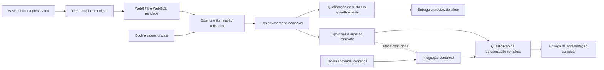

# Plano de desenvolvimento — LIV Ipanema: apresentação visual, WebGPU e unidades

Data do plano original: 09/10/2026. Atualização: 11/10/2026. Execução autorizada e iniciada. Exterior/interiores WebGPU/WebGL2, duas tipologias independentes, fila automática e pavimento piloto ilustrativo estão integrados no desktop e emulação de toque. A edição opcional da entrada reúne portal/marquise/guarita/placa revisados, recuos/cobertura corrigidos, cadastro aproximado e GLB correspondente no mapa; Canto conserva a moldura interna corrigida. Materiais PBR padrão permanecem reaproveitados. A política de atributos das instâncias passou no teto provisório de abertura fria do desktop, com imagens idênticas. T05–T12 continuam parciais: reload WebGPU, rede/memória, acabamento final, vínculos por final e qualificação física ainda precisam fechar seus critérios. Execução em [todo.md](todo.md); identidade da base em [baseline.json](baseline.json).

## Prioridades após a revisão de 11/10

A integração do GLB no mapa conclui a divergência entre a variante exibida na maquete e no entorno, com escala/implantação aproximadas preservadas. [MAPA-MODELO.md](../../experimentos/liv-ipanema-webgpu-2026-10-09/MAPA-MODELO.md) registra a revisão. O renderer regional continua no caminho preservado; T15 não foi antecipada. O exterior corrigido continua opcional até a qualificação física/rede/memória.

1. **Abertura e custo (T02/T05):** sombra fixa, reflexos preparados e atributos de instâncias qualificados no desktop. Página completa: entrada 2.489/2.427 ms frio/reload em WebGPU, 2.643/1.951 ms em WebGL2; base comparável 2.915/1.950 ms. Conteúdo inicial único 20.061.048 bytes, −47,7% vs. base. Os dois backends passam no teto frio provisório; reload WebGPU ainda +24,5% contra a base. Controle alternado e 99 comparações RGBA idênticas em [INSTANCIAS.md](../../experimentos/liv-ipanema-webgpu-2026-10-09/INSTANCIAS.md). Próximo: investigar reload, medir hospedagem/aparelhos e memória; manter as edições revisadas opcionais e não ampliar efeitos antes de qualificar o orçamento físico. T05 continua parcial.
2. **Entrada e leitura visual (T06/T07):** integração opcional concluída com cadastro aproximado, GLB regional conferido, sessão e fila. Maquete/luz em três perfis, mapa em sete casos, cinco casos reais e treze fixtures de fila passaram; o clique em Mapa escolhe a edição imediatamente, evitando um GLB alternativo antecipado. Canto e Meio preservados nos três modos, sem associação comercial por final. Próximo: fechar orçamento, confrontar verticalidade/fachadas e refinar vegetação/vidros próximos pelas fontes disponíveis. Forma/implantação continuam inferidas; ver [entrada/README.md](../../experimentos/liv-ipanema-webgpu-2026-10-09/modelo/entrada/README.md).
3. **Dia e entardecer (T07):** produzir dois estados coerentes, carregados pela prioridade já implementada, após a medição. Não apresentar direção artística como simulação solar.
4. **Vínculos e espelho (T08–T11):** conferir Canto/Meio e espelhamentos por final antes de associar um interior ao apartamento selecionado. Ampliar catálogo/espelho somente a partir do padrão demonstrado; conservar disponibilidade não informada até haver fonte comercial.
5. **Qualificação e entrega (T12/T13):** caminhada/giro, abertura e alternância no Poco X6 5G informado pelo usuário e em iPhone, além dos perfis desktop. Preparar pacote revisável antes de qualquer publicação solicitada.

As duas plantas já são experiências gerais separadas, com seus próprios bakes. As medidas/posições sem projeto executivo continuam identificadas como inferidas. A condição física permanece aberta; emulação não conta como ensaio no aparelho.

## Resultado pretendido

Evoluir a [versão publicada indicada pelo usuário](https://imobilaria-deccb-miniaturas--liv-mapa-5km-20261008-onn3ia42.web.app/maquete-liv-ipanema.html) para uma apresentação mais próxima da referência de tabela de vendas 3D: empreendimento bem apresentado, apartamentos selecionáveis, ficha e espelho sincronizados, mantendo plantas, tour e mapa do entorno.

A primeira entrega será um LIV com exterior refinado, renderização WebGPU quando disponível, alternativa WebGL2 verificada, cenas de dia e entardecer e um pavimento selecionável. A expansão para todas as unidades vem depois de comprovar o vínculo entre fachada, pavimento, final e tipologia. Preço e disponibilidade dependem de uma fonte comercial fornecida para esse fim.

Podemos avançar com as imagens, plantas comerciais e vídeos públicos já encontrados. A falta do projeto arquitetônico cotado limita a precisão das medidas e dos interiores, mas permite desenvolver a apresentação e o piloto de seleção. O produto continuará identificado como reconstrução visual aproximada enquanto essa conferência técnica estiver pendente.

O guia enviado pelo usuário é referência de resultado e experiência. Instruções internas do PDF não constituem pedidos de execução ou de publicação.

## Base fixada e situação atual

A base é o pacote `strict-circle-v3` em `experimentos/mapa-liv-ipanema-5km-2026-10-08/site-v3/`, correspondente ao endereço informado. O HTML baixado do endereço público tem o mesmo SHA-256 da cópia local. Não usar automaticamente o HTML canônico mais recente: ele contém diferenças em relação ao produto escolhido.

| Artefato | Tamanho exato | Identidade SHA-256 |
|---|---:|---|
| Maquete pública | 38.378.801 bytes | `31ffb45398aed3ad49b289600823232e37f668086ebfea458b96ecd2e1b9d018` |
| Mapa regional | 8.046.477 bytes | `54dc2fa36732e8efce3c3a21d8370e7bcccbfbf4e075e106170615ed465747e9` |
| GLB do LIV | 2.989.904 bytes | `f3bef61c2a844aae0062b1c15df7ebb942ed188c572ba455b8cddd86d57fadf1` |

Foi preservado o pacote completo em `backups/liv-webgpu-2026-10-09/site-v3/`: 126 arquivos, 58.313.188 bytes, com inventário de hashes em `backups/liv-webgpu-2026-10-09/inventario.json`. A pasta de backups é ignorada pelo Git; a cópia está neste computador e deverá entrar no armazenamento de artefatos do projeto para proteção fora dele.

O canal atual expira em **16/10/2026 às 09:12:58 BRT**. A expiração não impede o desenvolvimento local com a cópia preservada. Este planejamento não renova nem altera o canal.

Recursos que compõem o contrato da base:

- Maquete externa completa, com torre, portaria, piscina, acessos e paisagismo, inclusive depois de retornar dos modos interiores.
- Modos Maquete, Planta 2D, Planta 3D e Tour 3D; câmera livre, cinco enquadramentos, destaque de pavimento e captura PNG.
- Link “O que tem por perto?” para o mapa e retorno à maquete.
- Mapa estrito de 5 km, relevo ligado, implantação assentada, busca por nome/categoria, distância em linha reta e realce do local selecionado.
- Interface adaptada a larguras de celular. Os testes anteriores em navegador emulado comprovam parte do funcionamento; desempenho e estabilidade em aparelhos físicos ainda precisam ser medidos.

Os relatórios existentes registram 40.340 edifícios, 1.862 quadras, 614 POIs e 120 tiles de quintais no mapa, além de 56 malhas na miniatura, das quais 43 pertencem à implantação. Essas contagens identificam a edição atual; otimizações podem mudar a quantidade de malhas sem remover conteúdo.

### Reprodução corrigida na execução

`preparar_site.py` verifica o HTML fonte usando `publicacao/publicacao.json.htmlSHA256/htmlBytes`, que identifica uma publicação minificada anterior. A origem atual tem 53.580.328 bytes e hash `60a6d359…`; o registro minificado tem 52.891.777 bytes. O comando documentado pode falhar nessa comparação.

A T01 separou a identidade da fonte da identidade da publicação, manteve as verificações e produziu `EXP/site-baseline/` por promoção atômica. Dez testes e os QAs de miniatura/mapa passaram; 125 arquivos de conteúdo correspondem byte a byte à base. O commit exato da origem não foi demonstrado; o manifesto registra fontes locais e seus hashes. A correção está no commit `fa4730d`.

## Fontes e confiança

Usar o [dossiê de referências públicas](../../relatorios/liv-referencias-publicas-2026-10-09/README.md), com originais, páginas rasterizadas e procedência. Prioridade: filmagem real para volumes e vãos observáveis; book para distribuição proposta, acabamento e implantação; anúncios como acesso alternativo aos mesmos renders.

| Informação | Evidência disponível | Aplicação e limite |
|---|---|---|
| Fachadas e base | Vídeos oficiais de junho, julho e agosto/2026 | Corrigir silhueta, varandas, vãos e relação com lote/avenida; perspectivas não fornecem cotas exatas. |
| Aparência proposta | Book, galeria oficial e fachada ao entardecer | Materiais, paisagismo e direção artística; distinguir proposta do estado da obra. |
| Tipologias | Book, página 14: canto 47,59 m²; meio 47,5–47,89 m² | Construir duas bases de planta. Espelhamento e vínculo por final exigem conferência. |
| Implantação e finais | Book, página 15 | Conferir finais 01–10, acessos e lazer; orientação comercial não comprova implantação georreferenciada. |
| Quantidades | Book, página 16: térreo + 16 pavimentos tipo, 170 unidades, 175 vagas | Reconciliar o térreo e as repetições do modelo atual; o total não revela toda a numeração comercial. |
| Plantas executivas, estoque e preços | Ausentes | Medidas inferidas identificadas; disponibilidade “não informada”; preço e condições sem preenchimento. |

Criar uma matriz de evidências por parte do modelo: fonte/página/tempo do vídeo, observação, medida utilizada, confiança, decisão e captura de comparação. Estados de confiança: `confirmado`, `inferido`, `pendente`. A implantação espacial existente fica preservada até existir evidência suficiente para uma correção registrada.

## Arquitetura da evolução

Separar quatro responsabilidades para que uma melhoria de renderização não altere o cadastro comercial:

1. **Dados do empreendimento:** localização, implantação, pavimentos, finais, tipologias e evidências.
2. **Recursos visuais:** geometria, materiais, texturas, iluminação fixa, câmeras e níveis de detalhe.
3. **Visualizador:** renderizador, controles, seleção, modos, captura e recuperação de falhas.
4. **Dados comerciais:** identidade oficial da unidade, estado, preço, condições, data e origem da atualização.

Diretriz de materiais reafirmada pelo usuário durante a execução: aproveitar materiais PBR padrão do Three.js/GLTF e a conversão automática da `StandardNodeLibrary` para suas implementações em nós. Novos acabamentos devem entrar por configuração de propriedades e texturas, sem uma reescrita de shader por material. Manter TSL próprio apenas onde há comportamento específico, como o transporte RGBM da base; `ShaderMaterial`, `RawShaderMaterial` e `onBeforeCompile` personalizados exigem portabilidade explícita. `MeshPhysicalMaterial` também está mapeado no runtime 0.186.1 fixado. Conferir extensões/texturas de cada asset antes de incorporá-lo à cena.

O espelho pode funcionar com fichas físicas e disponibilidade desconhecida antes da chegada da tabela. A entrada comercial completa depende dessa tabela; a primeira demonstração visual não depende dela.

### Renderização

- Fixar uma versão do Three.js apropriada ao piloto, com módulos e loaders compatíveis. O runtime atual está embutido no HTML; alterar apenas o `package.json` da raiz não o migra.
- Inicialização assíncrona, detecção de capacidade e uso de `WebGPURenderer`, verificando explicitamente WebGPU e seu backend WebGL2. Se nenhum backend funcionar, oferecer ficha e planta 2D com mensagem compreensível.
- Portar os materiais personalizados para Nodes/TSL. `onBeforeCompile`/GLSL do caminho atual não pode ser considerado compatível pelo simples fato de haver fallback.
- Começar pela iluminação baked RGBM. Provar decodificação, espaço de cor, UV, intensidade e tone mapping sem duplicar a contribuição luminosa. Testar material representativo antes de migrar a cena.
- Preservar os atlas e UVs quando a geometria for a mesma. Geometria corrigida exige bake correspondente; atlas de outra miniatura ou de outra versão geométrica não serve como substituto.
- Portar captura PNG junto ao ciclo de renderização. Testar imagem efetivamente baixada nos dois backends; não pressupor que `preserveDrawingBuffer` resolva a captura no caminho novo.
- Migrar inicialmente o exterior do LIV. Os modos interiores podem permanecer no renderer atual, carregado sob demanda, até a sua migração em tarefa própria. Registrar essa separação e o custo de memória, encerrando o renderer inativo.
- Manter o mapa regional no caminho atual durante o primeiro piloto. O GLB aperfeiçoado será conferido no mapa para escala, orientação, implantação e aparência; a migração de todos os shaders urbanos será uma entrega posterior.

Essa combinação só será mantida se a troca de modos funcionar sem vazamentos e sem duplicação permanente de cenas/renderizadores. O usuário navega pelos modos normalmente; seleção de backend e comparação A/B ficam no ambiente de diagnóstico.

### Recursos e carregamento

Medir os bytes realmente transferidos: 38,4 MB é o tamanho do HTML em disco, não uma medição de rede comprimida. Separar recursos em pacotes de exterior, interiores/tipologias, estados de iluminação e entorno. Planta, tour e mapa serão carregados quando solicitados, com indicação de progresso e possibilidade de tentar novamente.

Aplicar instancing, simplificação de vegetação, resolução de texturas e compressão compatível com os dois backends após registrar a composição do custo. Não trocar indiscriminadamente tudo por um GLB: o arquivo externo existente pode não conter a mesma iluminação e o mesmo detalhamento da cena embutida. Comparar antes de escolher a representação.

Recursos terão versões/hashes e manifesto. Uma publicação conterá todos os arquivos necessários; o cache deverá impedir mistura entre dados e assets de edições diferentes. Atualização autorizada pelo usuário em 09/10/2026: a tela inicial tem prioridade; depois de utilizável, uma fila prepara **Tour 3D → mapa → Planta 2D** automaticamente. Abrir um desses modos interrompe a transferência de outro e prioriza o solicitado; arquivos completos são reutilizados em cache. A preparação transfere dados, sem abrir cenas/renderers ocultos. Não inclui cidade municipal, outras plantas, bancada PBR ou estados de luz. Interrupções reiniciam o arquivo incompleto até existir suporte qualificado a retomada por intervalo.

### Unidades e interação

Usar um ID técnico estável, separado da numeração comercial. Cadastro mínimo: pavimento, final, tipologia, orientação/transformação, referência ao volume de seleção, confiança do vínculo, numeração oficial opcional e origem dos dados. Não inventar números como “101” a partir de uma convenção presumida.

O piloto começa em um pavimento tipo com os dez finais. Usar volumes simples de seleção quando as malhas de fachada não separarem os apartamentos. Ao selecionar, a fachada realça a unidade, a ficha mostra os dados físicos e a planta 2D oficial correspondente fica disponível. Mouse, toque e teclado terão caminhos equivalentes; estados não serão comunicados apenas por cor.

Até T10, Planta 3D e Tour continuam como experiência geral da tipologia de referência existente, identificada como interior ilustrativo. Selecionar um final de meio não poderá apresentar o interior de canto como representação conferida daquele apartamento. O vínculo da seleção com um interior 3D específico será ativado após a construção e conferência das duas tipologias. A área de uma unidade só será individualizada quando confirmada; o intervalo publicado da tipologia de meio não será convertido em uma medida exata presumida.

A expansão separa canto e meio e confere quais finais usam cada tipologia ou versão espelhada. O térreo, gardens, áreas comuns e cobertura terão tratamento explícito. O total declarado de 170 unidades será usado para reconciliação, sem fabricar uma lista oficial de apartamentos a partir dele.

Espelho, ficha e fachada leem o mesmo estado. Enquanto a fonte comercial estiver ausente, exibir “disponibilidade não informada” e omitir preço/condições. Iluminação decorativa de janelas não representa automaticamente vendido ou disponível. Vagas numeradas na implantação não comprovam o vínculo vaga–apartamento.

## Marcos e portas de aceite

Os marcos abaixo são exclusivos deste roteiro; não substituem os marcos do Plano Diretor nem a homologação de outros imóveis.

| Marco | Entrega | Critério para avançar |
|---|---|---|
| LIV-M0 — base reproduzível | Pacote preservado, build isolado, matriz de referências e medições atuais | Artefatos identificados; fonte/publicação reconciliadas; capturas e métricas repetíveis. |
| LIV-M1 — renderizador provado | Exterior atual em WebGPU e WebGL2; RGBM, câmera, destaque e PNG | Paridade visual nas vistas fixas; todos os controles previstos funcionam; erros e fallback tratados. |
| LIV-M2 — qualidade visual | Fachadas/implantação conferidas, materiais e vegetação próximos, dia e entardecer | Comparação com fontes em três vistas; correções de volumes principais justificadas; orçamento de desempenho respeitado. |
| LIV-M3 — piloto de seleção | Um pavimento com finais, fichas e plantas 2D vinculados | Cada seleção aponta para o final correto; modos gerais preservados; interior 3D ainda sem vínculo conferido é identificado como ilustrativo. |
| LIV-M4 — apresentação completa | Canto/meio, cadastro reconciliado, espelho, ficha e qualificação física | Identidades consistentes; ausência comercial explícita; fluxos e captura passam na matriz de dispositivos. |
| LIV-M5 — dados comerciais | Importação validada da tabela autorizada, estados/preços sincronizados | Sem duplicados ou vínculos ambíguos; atualização identificada; fachada, ficha e espelho concordam. Condicional à fonte. |

Checkpoints técnicos após T01–T02, T03–T04, T05–T07, T08–T09 e T10–T12. Cada checkpoint entrega capturas, relatório dos dois backends quando aplicável e lista de diferenças abertas. Ajustes de escopo ficam registrados; uma falha de paridade não será apresentada como ganho visual.

### Ordem de execução

1. Reproduzir e medir a base. Em paralelo, registrar referências e conferir pavimentos/finais.
2. Provar RGBM/TSL em uma parte do LIV; então integrar o exterior completo e captura.
3. Reduzir o custo de entrada e refinar geometria/materiais/câmeras. Produzir estados coerentes de dia e entardecer.
4. Entregar o pavimento selecionável e qualificá-lo em aparelhos reais como primeiro preview de evolução.
5. Migrar interiores, completar tipologias e expandir o espelho. Integrar a tabela quando disponível.
6. Só depois avaliar migração integral do mapa, novos efeitos e simulação solar real.

A estimativa de calendário será feita após LIV-M0 e a prova RGBM de LIV-M1. São as etapas que revelarão o custo real da reprodução, da migração de materiais e do desempenho móvel. Até lá, a sequência e as dependências são o compromisso de execução; não há promessa de prazo ou multiplicação de FPS.

## Verificação e desempenho

Registrar equipamento, SO, navegador, backend efetivo, versão do runtime, resolução, DPR, câmera, estado de iluminação, rede/cache e versão dos recursos. Comparar base e evolução no mesmo dispositivo e cenário, com pelo menos três rodadas, separando abertura a frio e retorno com cache.

Medir transferência até a cena utilizável, tempo de abertura, compilação/inicialização, intervalo de quadros p50/p95 durante órbita, memória quando disponível, draw calls, triângulos e custo da troca de modos. Contadores de GPU e memória podem não estar disponíveis em todos os browsers; registrar ausência, sem substituir por estimativa apresentada como medida.

Metas propostas para fechar em LIV-M0: órbita utilizável de pelo menos 30 FPS no perfil móvel e 60 FPS no perfil desktop de referência; reduzir bytes iniciais e tempo de primeira cena frente à base; limitar regressão de p95 de quadro a 10% nas mesmas condições e perfil. Metas não atingidas exigem reduzir efeitos/resolução/LOD ou registrar a limitação antes da entrega. Esses valores são critérios a validar, não resultados já medidos.

### Matriz mínima de qualificação

| Ambiente | O que precisa comprovar |
|---|---|
| Desktop com WebGPU efetivo | Inicialização, paridade, órbita, seleção, quatro modos, PNG e troca de luz. |
| Desktop forçado em WebGL2 | Os mesmos fluxos; material RGBM/TSL e mensagem de recuperação após falha. |
| Android físico de capacidade intermediária | Toque, abertura a frio, estabilidade/memória, órbita, seleção, orientação e captura; registrar backend efetivo. |
| iPhone físico | Os mesmos fluxos em Safari; backend efetivo e alternativa disponíveis no aparelho. |
| Navegadores internos de WhatsApp/Instagram | Abertura por link, navegação e alternativa quando o backend disponível for limitado. |
| Sem backend 3D | Ficha/planta 2D utilizáveis; erro inteligível e tentativa de recuperação sem tela vazia. |

Layouts: 320, 390, 768 e 1440 px; retrato/paisagem; alvos de toque próximos de 44 px; sem controles sobrepostos nem rolagem horizontal. QA headless e emulação de viewport complementam aparelhos físicos e não comprovam performance real.

### Regressões obrigatórias

1. Retorno à Maquete repõe torre e implantação completas depois de cada modo interior.
2. Planta 2D continua correta; Planta 3D e Tour conservam móveis, navegação, circulação e controles existentes.
3. Câmera livre, cinco vistas e destaque/reset de pavimento funcionam sem remover áreas externas.
4. PNG baixado corresponde à vista ativa e possui conteúdo válido em ambos os backends do exterior.
5. Maquete → mapa → maquete preserva os caminhos públicos; busca, distância, realce, teclado e estado vazio funcionam.
6. Mapa conserva limite estrito de 5 km, chão contínuo, relevo, implantação e pacote regional, sem requisitar cidade completa.
7. Sem falhas HTTP/console não tratadas, vazamentos na troca repetida de modos ou mistura de assets de versões diferentes.
8. No perfil piloto, cadastro, realce, ficha e planta 2D apontam para o mesmo final; modos 3D gerais mantêm a indicação de interior ilustrativo. No perfil completo, incluir tipologia 3D conferida e espelho sincronizados com a unidade. Informação ausente continua ausente.

Usar os QAs existentes `qa_miniatura.py` e `qa_mapa.py` do experimento como ponto de partida. Adaptar o QA canônico de pavimento/PNG: `qa_viewer.py` assume `#verConjunto`, removido nesta base. Separar destinos dos relatórios: hoje `verificar_http.py` e parte dos geradores ainda gravam evidências na pasta original. Não sobrescrever o QA da versão publicada.

## Dependências, riscos e resposta

| Risco/dependência | Resposta e ponto de decisão |
|---|---|
| RGBM incompatível ou aparência divergente | Prova T03 antes da cena inteira; conservar visualizador atual recuperável até paridade. |
| WebGPU sem ganho no dispositivo de referência | Medir ambos; reduzir custo de cena; manter alternativa funcional. A API não é prova de desempenho. |
| Peso inicial/duplicação de runtimes | T05 separa recursos e encerra renderer inativo; verificar memória em alternância repetida. |
| Correção geométrica invalida bake | Regerar UV/bake da própria geometria; manter versões e manifesto compatíveis. |
| Falta de cotas/projeto original | Priorizar elementos comprovados, registrar aproximações e evitar afirmar precisão arquitetônica. |
| Tipologia e numeração comercial ambíguas | Conferir primeiro um pavimento; IDs técnicos, vínculo pendente e expansão apenas do padrão demonstrado. |
| Tabela de vendas indisponível | Entregar seleção e espelho com disponibilidade não informada; LIV-M5 aguarda fonte. |
| Sol móvel sobre sombra fixa | Dia/entardecer com iluminação coerente por estado; simulação por data/hora em etapa posterior. |
| Preview expira | Pacote preservado e inventário; novo canal preparado quando houver entrega solicitada. |
| Trabalho local concorrente | Evolução em experimento próprio; preservar alterações de outros trabalhos e não regenerar destinos históricos. |

## Extensões depois da primeira entrega

- Migrar integralmente materiais e shaders do mapa de 5 km após comprovar o exterior e os interiores. Preservar recorte, terreno, busca, instancing e carregamento por tiles.
- Simulação solar por localização/data/hora após validar norte, coordenadas e implantação, com luz direta separada das contribuições e sombras fixas. O rótulo “simulação solar” depende dessa coerência.
- Integração de estoque com autenticação, atualização e histórico quando a operação definir fonte e responsáveis; a primeira importação pode ser arquivo validado.
- Interiores de maior realismo, acabamentos configuráveis ou novos tours quando houver referência e orçamento de desempenho. Não criar 170 interiores únicos: reutilizar tipologias confirmadas e instâncias.

Essas extensões ficam fora do requisito do primeiro preview. Não incluir uma reconstrução ampla de São Carlos, regras de financiamento inventadas ou mudanças globais nas outras miniaturas para concluir o LIV.

## Entrega, publicação e recuperação

Trabalhar em `experimentos/liv-ipanema-webgpu-2026-10-09/` ou diretório de execução equivalente, com fontes, assets versionados, manifestos e evidências próprios. Gerar pacote local com os caminhos públicos atuais; preparar preview separado e relatório antes de qualquer publicação solicitada. Usar a configuração específica de miniaturas, conferindo projeto/site e os hashes de todos os recursos.

O pacote de entrega incluirá: versão, fontes de referência, diferenças contra a base, métricas, capturas comparativas, resultados por dispositivo/backend, pendências comerciais e instruções de recuperação. Manter o pacote preservado como retorno imediato se a evolução falhar. Expiração/rollback de canal deve ser explícito; não substituir o link-base silenciosamente.

O plano foi elaborado em 09/10 e sua execução foi autorizada em seguida. As revisões locais estão registradas em `todo.md`; publicação continua uma etapa própria da entrega solicitada.

## Documentação técnica de apoio

- [Three.js — WebGPURenderer](https://threejs.org/manual/pages/webgpurenderer.html): migração, materiais Nodes/TSL, backend WebGL2 e limites do caminho experimental.
- [API WebGPURenderer](https://threejs.org/docs/pages/WebGPURenderer.html): inicialização e configuração do renderer.
- [GLTFLoader](https://threejs.org/docs/pages/GLTFLoader.html) e [exportação glTF no Blender](https://docs.blender.org/manual/en/5.1/addons/import_export/scene_gltf2.html): troca de geometria e materiais; compatibilidade deverá ser conferida na versão fixada do piloto.
- [WebGPU nos principais navegadores](https://web.dev/blog/webgpu-supported-major-browsers): panorama de suporte; detecção efetiva e teste no aparelho continuam necessários.
