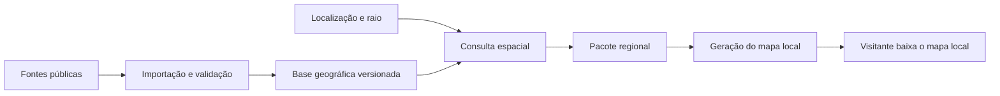

# Plano: base geográfica própria e mapas regionais de Cuiabá

Data: 08/10/2026. Estado: proposta para implementação; nenhum dado de Cuiabá foi importado e nenhum piloto foi executado neste planejamento.

Atualização após inspeção autorizada do SIG: há [amostra técnica extraída](../../relatorios/mapa-regional-cuiaba/sig-2026-10-08/README.md), ainda fora da base proposta. A API individual devolve polígono do lote e o WMS exporta GeoJSON regional de lotes, edificações, quadras e bairro. A exportação WMS apresenta clipping e a amostra individual tem divergência entre área geométrica e cadastrada. O plano permanece pendente de validar entidades completas, qualidade, cobertura e condições de reutilização.

## Resultado pretendido

Preparar uma base geográfica reutilizável. Ao cadastrar um empreendimento, informar sua localização e escolher o raio de 2.500 ou 5.000 metros. O gerador consulta nossa base, obtém apenas o entorno necessário e produz o mapa daquele empreendimento. A coleta dos fornecedores acontece na preparação e atualização da base, separadamente da geração dos mapas.

O usuário informou que ainda não há empreendimento em Cuiabá. O piloto terá pontos técnicos identificados como testes, sem ficha comercial ou miniatura atribuída a imóvel real. A localização virá do cadastro; não será inferida da imagem da miniatura.

Os roteiros existentes continuam em seus próprios arquivos. Este plano e sua [lista de tarefas](todo.md) seguem a convenção do projeto de diretórios por trabalho.

## Fluxo proposto



Há duas transferências diferentes: a aquisição inicial dos fornecedores e a entrega de um pacote da nossa base ao gerador/visitante. Após a região estar preparada, um novo empreendimento não precisa repetir a aquisição externa. A preparação pode baixar arquivos maiores quando a fonte só oferece extratos ou folhas completos.

## O que existe hoje

- `pipeline/nova_cidade.py` e `pipeline/build/config.py` já permitem configuração por cidade. Ainda não há configuração de Cuiabá.
- `pipeline/montar.py` lê o acervo e aplica `Recorte` aos blocos durante a montagem. `pipeline/imovel.py` centra esse recorte no lote do cadastro.
- O piloto atual usa 2.500 m, mas `pipeline/recorte.py` mantém POIs, relevo e vegetação inteiros. Alterar apenas esse raio não implementa a proposta.
- `pipeline/fontes/overture.py` já adquire edificações por bbox municipal. O adaptador regional precisará receber uma área explícita.
- `pipeline/fontes/osm_extract.py` usa por padrão um PBF do Sudeste e seu parser de `--pbf` precisa ser corrigido antes de usar o Centro-Oeste. A extração atual também precisa ser auditada para geometrias e relações que cruzam a borda.
- `pipeline/build_imovel.py`, `pipeline/fabrica_miniaturas.py` e `pipeline/preparar_piloto.py` usam a configuração do piloto de São Carlos. O caminho regional deve receber cidade/pacote explicitamente.
- `pipeline/build/pacotes.py` ainda pode incluir biblioteca e atlas de exteriores de São Carlos em outra cidade. Geometrias e posições específicas dessa cidade não podem preencher lacunas de Cuiabá.
- O relevo do renderizador pressupõe uma grade quadrada e uma origem coerente com `__cidade.centro`. O pacote regional precisa fornecer uma única origem para vetores, rasters e câmera.

## Cobertura e fontes

“Todas as informações” significa todas as camadas necessárias ao perfil escolhido, com sua cobertura e qualidade registradas. Não significa que cada edifício tenha altura conhecida, que existam lotes oficiais acessíveis ou que haja levantamento de árvores individuais.

| Camada | Fonte e aquisição proposta | Estado e uso no piloto |
|---|---|---|
| Limite administrativo | [IBGE — malhas territoriais](https://www.ibge.gov.br/geociencias/organizacao-do-territorio/estrutura-territorial/15774-malhas); selecionar Cuiabá, código 5103403 | Delimitar a área da base; confirmar arquivo/edição na importação. Limite municipal não é limite de lote. |
| Ruas, água, áreas verdes e POIs | [OSM via extrato Centro-Oeste da Geofabrik](https://download.geofabrik.de/south-america/brazil/centro-oeste.html), importado uma vez | Extrato disponível. Registrar data/hash; preservar nós e relações necessários. Completude local ainda não foi medida. |
| Edificações | [Overture — download por bbox](https://docs.overturemaps.org/getting-data/overturemaps-py/) em GeoParquet; fixar a versão consultada | Consulta regional confirmada. [Contornos e alturas](https://docs.overturemaps.org/guides/buildings/) exigem amostragem local; um contorno de telhado não representa lote cadastral. |
| Relevo | [INPE — TOPODATA](https://data.inpe.br/dados/topodata/), COG/GeoTIFF | Cobertura nacional. Modelo de superfície com pixel refinado de aproximadamente 30 m, derivado de dados de aproximadamente 90 m; adequado ao contexto visual, sem equivalência a levantamento do empreendimento. |
| Vegetação/cobertura do solo | Áreas verdes do OSM no primeiro perfil; [MapBiomas 10 m](https://brasil.mapbiomas.org/iniciativas-e-produtos/cobertura-e-uso-da-terra/cobertura-10m/cobertura/) no enriquecimento | Validar exportação automatizada, coleção e ano antes de torná-lo obrigatório. Não fornece árvores individuais. |
| Bairros, quadras e lotes municipais | [SIG indicado pela Prefeitura de Cuiabá](https://www.cuiaba.mt.gov.br/secretarias/economia/sig-cuiaba), que aponta para o [portal público](https://app.smartgis.net.br/cuiaba/publico/) | API individual com GeoJSON e exportação WMS regional confirmadas em amostra. Saída de mapa é recortada; geometria completa, qualidade/cobertura e condições de reutilização ainda precisam ser validadas. |
| Endereços | OSM e cadastro do empreendimento; CNEFE como enriquecimento posterior | Não bloquear o teste pela ausência de numeração completa. Confirmar arquivo e cobertura municipal antes da importação do CNEFE. |

Guardar a atribuição e as condições de uso de cada conjunto no catálogo e no pacote. A [documentação do Overture](https://docs.overturemaps.org/attribution/) diferencia as fontes e seus termos; não aplicar uma licença única a todo o acervo.

### Área de estudo

1. Primeiro demonstrador: uma área urbana de referência que contenha integralmente os raios dos dois primeiros pontos de teste e a margem de processamento. Fixar seu polígono e os pontos antes das medições.
2. Validação ampliada: quatro pontos — centro denso, expansão urbana, proximidade do Rio Cuiabá/Várzea Grande e baixa densidade. Suas coordenadas serão selecionadas e registradas na primeira tarefa; não foram inventadas neste plano.
3. Base de cidade: ampliar para Cuiabá com uma faixa externa de pelo menos 5 km **mais a margem de processamento**. O raio do imóvel pode atravessar a fronteira municipal. Registrar a cobertura real por camada, inclusive nos municípios vizinhos.

Começar pelo demonstrador reduz o custo de avaliar a arquitetura. O serviço para empreendimentos em qualquer ponto da cidade só será declarado disponível depois da expansão e validação dessa cobertura.

## Estrutura dos dados

A [decisão proposta de armazenamento](decisao-base.md) recomenda PostgreSQL/PostGIS para consultas espaciais e arquivos em armazenamento próprio para os originais, rasters e pacotes. O piloto começa localmente; o cadastro de imóveis continua usando sua estrutura atual.

| Conjunto | Conteúdo mínimo |
|---|---|
| `geo_sources` | Provedor, URL, camada, versão/edição, data de aquisição, licença/atribuição, CRS original e checksum. |
| `geo_snapshots` | Identidade de uma edição coerente da base; fontes fixadas, estado de validação e política de precedência. |
| `geo_coverage` | Polígono e estado da importação por camada/snapshot, contagens, rejeições, limitações e qualidade amostrada. |
| `geo_features` | ID original e provedor, snapshot, tipo de feição, geometria, atributos disponíveis e procedência por atributo enriquecido. |
| `geo_rasters` | Referência do arquivo, extensão espacial, resolução, transformação da grade, CRS, nodata e referência vertical. |
| `regional_packages` | Centro/raio/perfil, snapshot, versões do gerador e biblioteca, manifesto, contagens, hashes e localização dos arquivos. |

Importação completa indica que o arquivo foi lido e validado; não prova que o fornecedor mapeou todos os objetos reais. Valores desconhecidos continuam desconhecidos. Estimativas de alturas, quadras ou lotes terão origem explícita e serão separadas dos dados observados.

Preservar originais para reproduzir um mapa e comparar atualizações. Importar novas versões sem substituir a versão usada em pacotes existentes. Geometrias compartilhadas entre áreas não devem ser duplicadas por empreendimento.

## Contrato do pacote regional

Entrada mínima: `cidade=cuiaba`, latitude, longitude, `raio_m=2500|5000`, perfil e snapshot. Identidade comercial e geometria do empreendimento entram quando houver um cadastro real; não são exigidas para testar o entorno.

O manifesto conterá:

- Centro, raio em metros, bbox de aquisição e margem de processamento.
- Origem do mapa, CRS geográfico e projeção métrica usada nas derivações.
- Snapshot, fontes e suas versões, política de qualidade e camadas opcionais ausentes.
- Contagens por camada, bytes lidos/exportados, limites dos rasters e arquivos com hashes.
- Versão do pipeline, parâmetros, semente determinística e versões das bibliotecas compartilhadas.
- Perfil de renderização, limites de navegação e exceções de borda explicitamente retidas.

O primeiro perfil incluirá edifícios, ruas, grupos de quadras, chão/asfalto, áreas verdes e POIs disponíveis. Água será adquirida e armazenada na base, mas sua representação visual não está implementada nesse caminho do legado e fica para um enriquecimento separado. Relevo, cobertura raster e parcelamento também entram em perfis de enriquecimento. Uma lista de POIs validamente vazia difere de falha de importação. O primeiro perfil deve aparecer no relatório como contexto urbano, sem afirmar precisão cadastral dos terrenos.

### Seleção espacial e borda

Usar bbox como filtro preliminar e distância/interseção em metros para a seleção final. No PostGIS, [ST_DWithin com geography](https://postgis.net/docs/ST_DWithin.html) aceita metros e pode usar índice espacial. O índice deve corresponder à coluna/expressão consultada.

Selecionar edifícios e áreas pela geometria, não somente pelo centroide. Manter entidades completas e as dependências que o processamento exige; não fechar um polígono usando apenas os nós que sobraram dentro da bbox. Resolver relações/multipolígonos, conectividade viária e grupos de quadras antes de gerar as malhas.

Começar com margem de processamento proposta de 300 m, configurável e sujeita ao teste de borda. A margem não substitui dependências completas de entidades. Se quadras ou relações exigirem uma região maior, ampliar a aquisição/consulta e registrar a extensão. O pacote final deve conter apenas feições do entorno e dependências/exceções justificadas; a margem inteira não deve virar download automático do visitante.

Recentrar o pacote na âncora é a proposta para reaproveitar o raster quadrado do renderizador. Transformar todos os vetores, registros, câmera e rasters para essa mesma origem. Comparar geometrias entre pacotes após convertê-las ao referencial comum. Não regravar o JSON municipal a cada empreendimento.

### Cobertura, cache e atualização

- Verificar cobertura antes da consulta. Uma camada obrigatória com aquisição incompleta retorna estado específico e não um mapa aparentemente completo. A camada opcional ausente fica registrada no perfil.
- Exportar um pacote reutilizável por hash de centro/raio/perfil/snapshot/versões/parâmetros. Coordenadas e parâmetros terão serialização canônica; arredondamento não pode deslocar silenciosamente o centro.
- Repetir o mesmo pedido reutiliza o pacote validado. Um ponto próximo consulta a mesma base; pode criar novo pacote, mas não reimporta fornecedores.
- A preparação de uma região ainda ausente será um job separado. Se a fonte só oferece arquivo grande, reutilizar esse download para outras áreas.
- Atualizações são ações separadas e geram snapshots novos. Nenhuma automação será criada como consequência deste plano.

## Integração no projeto

| Entrega | Integração prevista |
|---|---|
| Cidade Cuiabá | Novo `padrao/cidades/cuiaba.json`, com cobertura e CRS validados; sem copiar geodados de São Carlos. |
| Aquisição | Adaptadores em `pipeline/fontes/`, com área explícita e importação na base. Corrigir seleção do PBF e parser existente. |
| Consulta e manifesto | Novo módulo `pipeline/regional/`, separado da montagem HTML. |
| Derivações | Converter/classificar OSM e Overture para `city_v2`, construir `faces_ruas` a partir do grafo regional e então alimentar `pipeline/city_base.py` e a triangulação de ruas/chão. Processar somente a região selecionada. |
| Configuração por pacote | `pipeline/build/config.py` fornece uma `Cidade` derivada do manifesto, com arquivos e origem regionais; comportamento municipal atual continua disponível. |
| Bibliotecas e rasters | `pipeline/build/pacotes.py` recebe política de cobertura; POIs/relevo/vegetação já chegam locais. Bibliotecas genéricas de malhas ficam compartilhadas. |
| Montagem e identidade | `pipeline/montar.py`, `pipeline/imovel.py` e `pipeline/build/manifest.py` consomem o pacote. Reaproveitar os gates de identidade de `Recorte`. |
| Empreendimento real | Em etapa posterior, `build_imovel.py` recebe cidade, localização, raio e pacote explicitamente, em vez de depender somente do piloto de São Carlos. |

`bl[]` e os registros usados pelo streaming precisam continuar válidos. Quadras derivadas das ruas são grupos de renderização; não devem ser apresentadas como cadastro oficial. O caminho de menor risco mantém o formato decodificado atualmente pelo renderizador e acrescenta a preparação regional antes dele.

Identidade dos dados observados e aparência procedural são verificações diferentes. Recentrar o mapa pode alterar hashes de posição usados por árvores e outros detalhes do runtime; manter a mesma semente não basta para garantir as mesmas escolhas. O primeiro protocolo compara geodados no referencial comum e registra diferenças procedurais separadamente. Se a aparência idêntica entre pacotes for exigida, acrescentar uma entrega própria que use IDs estáveis ou coordenadas globais para essas escolhas, antes de afirmar equivalência visual.

Interface de trabalho proposta, **ainda não implementada**:

```text
preparar_base(cidade, area, fontes_fixadas) -> snapshot_validado
gerar_entorno(cidade, centro, raio_m, perfil, snapshot) -> pacote_validado
montar_mapa(pacote_validado) -> mapa_local
```

API pública, painel de seleção de raio e infraestrutura remota serão avaliados depois do teste local. O consumidor previsto é o worker de geração, que baixa o pacote da nossa base; o visitante recebe os artefatos prontos.

## Sequência e checkpoints

As tarefas pequenas, dependências e verificações estão em [todo.md](todo.md).

1. Inventariar fontes, escolher pontos e registrar cobertura/qualidade. Definir o contrato do pacote e as métricas.
2. Preparar armazenamento local e importar uma área mínima versionada. Verificar índices, entidades completas e repetição de importação.
3. Consultar e gerar o primeiro mapa de 2,5 km a partir da base. Comparar com uma referência maior feita das mesmas fontes e regras.
4. Gerar o mapa de 5 km e outro centro próximo sem repetir downloads externos. Confirmar cache, identidade e bordas.
5. Acrescentar relevo/vegetação por janelas regionais e repetir a comparação usando perfis idênticos.
6. Validar os quatro pontos, expandir a cobertura da cidade e integrar um cadastro real quando ele existir.

Não é necessário modelar um empreendimento fictício para provar a arquitetura. O primeiro checkpoint deve entregar um mapa de contexto funcional a partir de coordenadas técnicas.

## Experimento e critérios de aceite

Criar uma referência maior de Cuiabá e pacotes de 2,5/5 km com **a mesma edição dos dados, o mesmo perfil e os mesmos parâmetros de transformação**. A referência deve conter os raios e suas dependências. O preparo da base é medido separadamente; não escondê-lo no resultado de geração.

| Verificação | Critério |
|---|---|
| Origem dos dados | Nenhuma geometria/posição/atlas geográfico de São Carlos entra nos mapas de Cuiabá. Malhas genéricas compartilhadas são identificadas separadamente. |
| Identidade | IDs, atributos conhecidos e geometria observada preservados no domínio comum. Remapeamento dos índices de edifícios e modelos mantém nome, altura e seleção corretos. Diferenças procedurais decorrentes da origem são registradas separadamente. |
| Borda | Sem edifícios cortados, polígonos fechados artificialmente ou quadras quebradas; feições atravessando o círculo são retidas conforme a política registrada. |
| Cobertura | Falha ou lacuna de importação não é apresentada como ausência real de objetos; perfis e limitações aparecem no relatório. |
| Reutilização | Mesmo pedido usa o pacote existente. Outro ponto coberto não consulta fornecedores externos. |
| Trabalho regional | Logs/contagens mostram leitura e derivação do subconjunto antes da montagem; não basta esconder objetos após baixar a cidade. |
| Peso | Medir bytes comprimidos e brutos por camada, bibliotecas e transferência total real. A redução geográfica precisa superar o ruído; definir a meta numérica após a baseline. |
| Geração | Medir consulta, exportação, derivações, montagem, tempo total e pico de memória. Comparar cinco execuções por cenário, distinguindo cache frio e quente. |
| Navegador | Medir tempo até interação, memória disponível e navegação em desktop/mobile com mesmas condições; registrar lacunas de medição. |
| Atualização | Novo snapshot não muda pacote antigo; o mesmo snapshot e gerador produzem hashes reproduzíveis. |

Registrar bytes recebidos dos fornecedores na ingestão, leituras da base por geração, bytes entregues ao worker e bytes efetivamente transferidos ao navegador. Ler alguns metadados/índices é esperado; ler e desserializar todo o acervo municipal em cada empreendimento não é o resultado pretendido.

A navegação no piloto terá limite coerente com o pacote e enquadramento que não exponha uma borda abrupta na vista inicial. Expansão durante navegação será outra entrega, caso seja necessária; o teste primeiro demonstra a geração de mapas de alcance definido.

## Riscos e decisões pendentes

| Questão | Tratamento |
|---|---|
| SIG com exportação amostral recortada e divergência cadastral | Confirmar geometria completa e condições de reutilização; conciliar IDs, área e versão. Não tratar a amostra WMS como cadastro íntegro nem substituir divergências por lotes sintéticos. |
| Dados públicos incompletos ou sem alturas | Medir cobertura por amostra e marcar estimativas. Disponibilidade do fornecedor não prova precisão local. |
| Algoritmos de quadras dependem do entorno | Margem configurável, dependências completas e comparação com a referência maior antes de aceitar o recorte. |
| Rasters ainda municipais no legado | Perfil regional próprio com grade/origem explícitas e testes de alinhamento; medir janelas lidas. |
| Custo de uma base própria | Medir armazenamento, importação e consultas. PostGIS é proposta, sem contratação de servidor neste turno. |
| Ausência de empreendimento real | Pontos técnicos permitem testar arquitetura e entorno. Vínculo da miniatura e precisão do cadastro comercial exigem validação futura. |

## Entregáveis do teste futuro

- Catálogo de fontes e cobertura, com uma edição reproduzível da base própria.
- Dois mapas do mesmo ponto, de 2,5 e 5 km, e um mapa de outro centro coberto.
- Manifestos, relatórios de identidade/borda e comparação de peso, tempo, memória e custo.
- Matriz dos quatro pontos técnicos e situação de lotes/endereços/alturas oficiais.
- Decisão registrada sobre ampliar a base para toda Cuiabá e sobre infraestrutura remota.

A entrega deste turno é o plano, a decisão proposta e a lista de tarefas. Não há resultado de desempenho ou completude de Cuiabá a declarar ainda.
